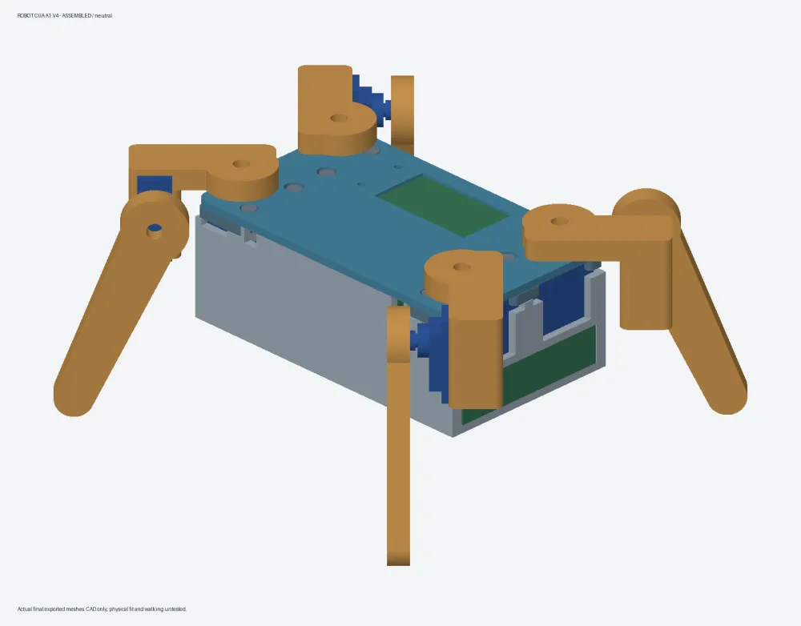
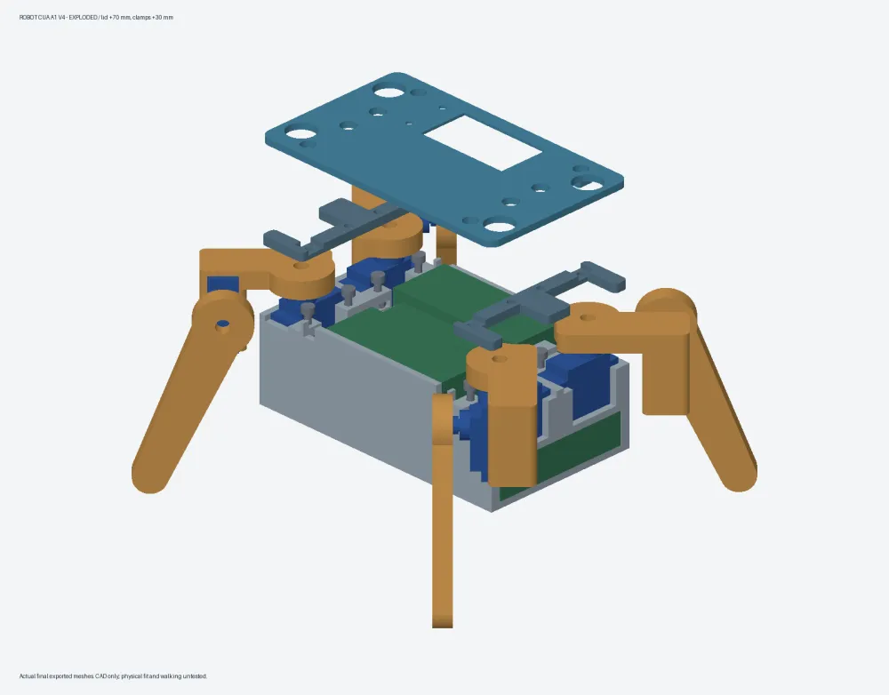
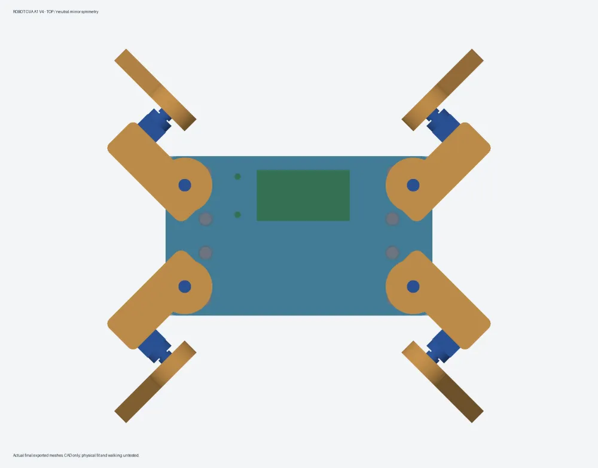
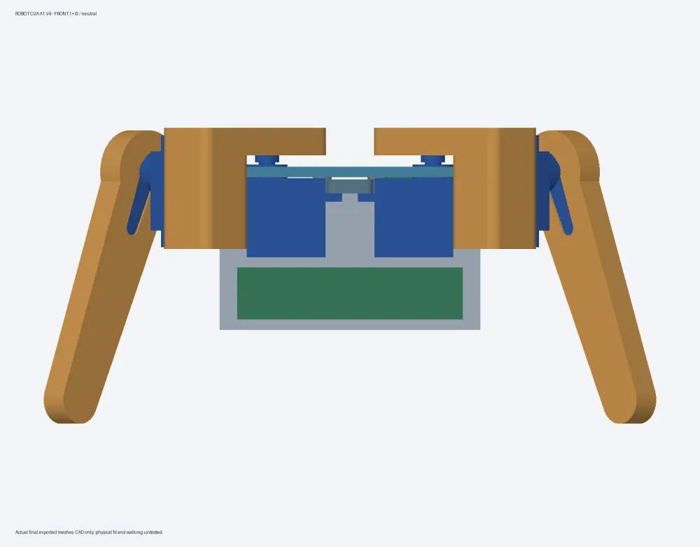
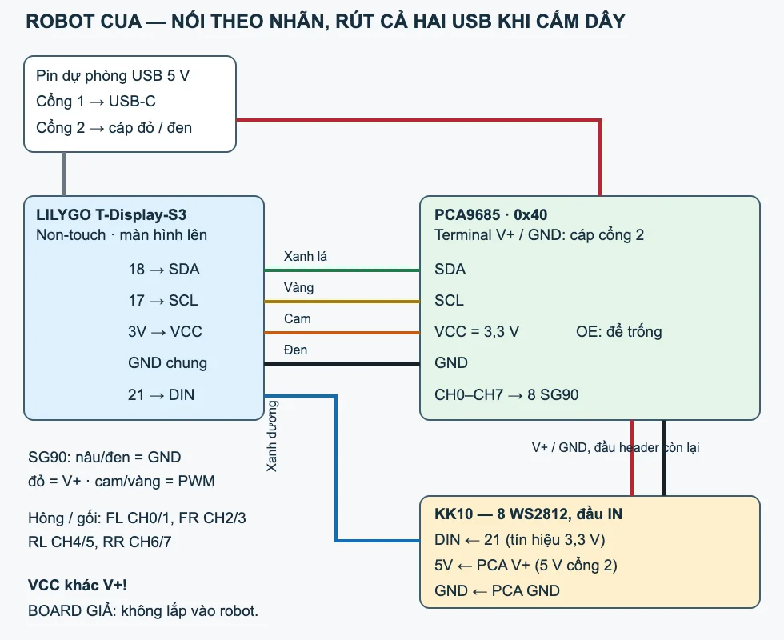
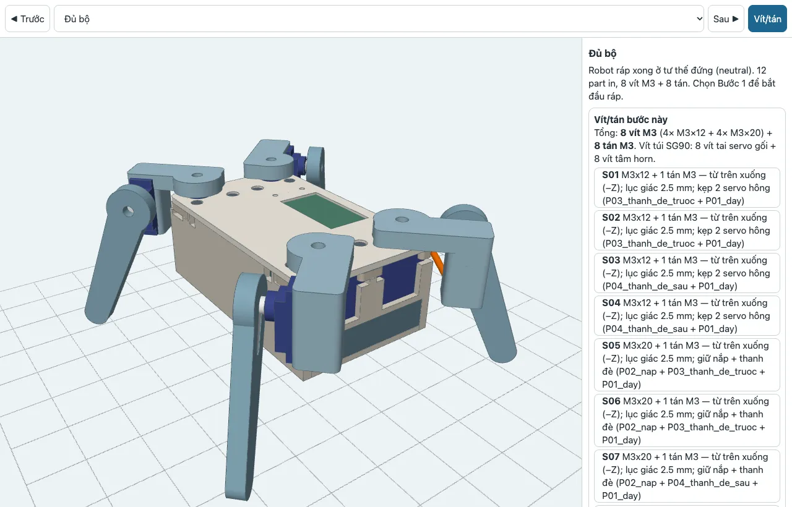
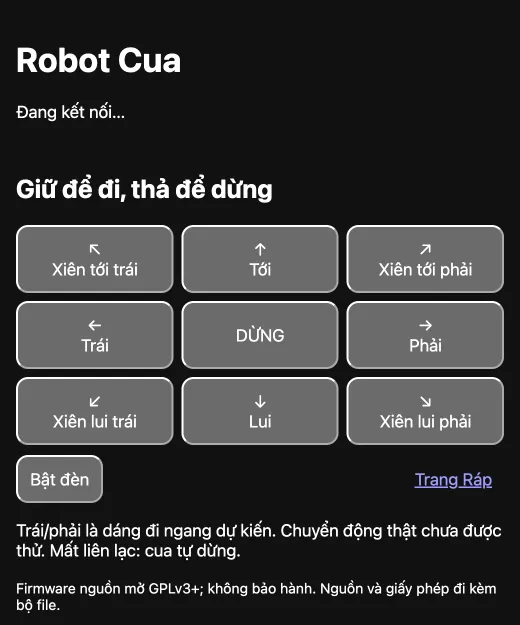

# Crab Robot A1 V4

A four-legged toy crab with 8 SG90 servos. Scan a QR code to join Wi-Fi, then drive it from a web page on your phone. Electronics: LILYGO T-Display-S3 (non-touch) + PCA9685 servo driver + 8-LED WS2812 bar, powered by a two-port 5 V USB power bank. Everything is hand-wired; **the 30×20 mm KiCad board is a dummy for the schematic only — it is not ordered or fitted.**

**Source baseline: 6 Nov 2026**, independently checked (`teamReady=true`). The owner has since flashed a newer workspace firmware and confirmed QR, web and Wi-Fi scanning on 9 Nov; PCA9685 is still to be purchased and no motors have been tested. This repository update adds documentation; CAD/firmware sources remain the 6 Nov baseline. **LED DIN differs: baseline GPIO21; owner’s flashed firmware GPIO1.** See the [version/status table](docs/STATUS.md) and [PCA9685 buying/wiring guide](docs/PCA9685-VA-DAU-DAY.md).

Tiếng Việt: [README.md](README.md)

## Getting started

1. Look at the [BOM](BOM.md) and the [gallery](#gallery) below.
2. **Print the test pieces first:** [TEST ONLY + MATING_TEST](case/print/TEST-ONLY-coupons.3mf). The coupons are not part of the robot; if the two MATING_TEST parts fit, keep them as P05/P09. Go through the [checklist](CHECKLIST-RAP.md) and confirm both tests pass before printing the production plates.
3. Follow the [step-by-step assembly overview](case/overview.html): Full kit → Step 1…9, with a screw/nut card and wiring notes per step.
4. [Wire it](firmware/WIRING.md), then [flash the firmware yourself](firmware/README.md). Unplug the servo power USB while flashing.
5. Scan the Wi-Fi QR, pick your 2.4 GHz home network and enter the password, then scan the web-address QR. If the page does not open, go to `http://192.168.4.1/`. Hold a button to walk, release to stop; if the 600 ms heartbeat is lost the gait stops and the robot eases back to standing. The Assembly page centers, trims and saves the servos. Hold BOOT for 8 s to clear Wi-Fi.

## Gallery

All images are CAD renders or screenshots of the generated files — physical completion and fit are unconfirmed. These images show the original closed-body baseline, not the newer skeleton revision.

| | |
|---|---|
|  |  |
| **Exploded view** — lid and clamp bars lifted off the base | **Top view** — lid with the T-Display window |
|  |  |
| **Front view** | **Wiring** — LILYGO T-Display-S3 → PCA9685 → 8 SG90 + LED bar ([full](firmware/wiring.svg)) |

 
<b>Assembly overview</b> (<code>case/overview.html</code>) — interactive 3D, one step at a time, with the screws for each step

 
<b>Phone control page</b> served by the robot — hold an arrow to walk, release to stop (UI text is Vietnamese)

## Current build

| Item | Value |
|---|---|
| Body (without legs) | 126×75×47 mm, including lid screw heads |
| Parts / screws | 12 parts; 4× M3×12 + 4× M3×20; 8× M3 nuts; SG90 screws from the servo bag |
| Print | 2 PETG plates, ~4h27 + 2h30 = 6h57; 186.9 g |
| Robot with battery | ~430–440 g **estimated** — weigh it when assembled |
| Joint range | ±30° in CAD, checked every 5°, min clearance 3.3 mm; all four legs in phase |
| Symmetry (STEP) | 0 mm / 0°; not checked on a print |
| Firmware | Builds for ESP32-S3; host tests pass for Wi-Fi, web, QR, API, assembly mode, BOOT, gait and PCA9685 |

[Print all](case/print/production.3mf) holds all parts P01–P12: plate 1 = base + lid, plate 2 = legs + clamp bars.

Print settings used: Bambu A1, 0.4 nozzle, PETG Basic (flow-rate calibrated), 0.20 mm layers, 2 walls, 7% grid infill, tree supports (auto). Part orientation and assembly notes are in the [case guide](case/README.md) and the [fastener map](case/fastener_map.csv).

## Assumptions — check by hand

- SG90/horn, LILYGO case/Dupont pins, PCA9685 and LED bar sizes come from reference models, not measured from the owner's parts.
- Power bank: max 100×65×15 mm, 120 g, ≥2.4 A per port.
- WS2812 data driven directly at 3.3 V is untested: keep the DIN wire short and next to GND; if it flickers, unplug the LED bar and use the robot without it.
- Still to check on the real robot: servo horn/pocket fit (use the coupon), wire bend under the LILYGO/PCA, QR scanning with the lid closed, real servo direction, leg grip, and whether the power bank auto-shuts off.
- Sideways walking comes from a simple kinematic model, not a floor-contact simulation. The default gait is slow to limit current spikes.

Pass/fail steps for all of these are in [CHECKLIST-RAP](CHECKLIST-RAP.md) — no electrical measuring needed.

## Build from source

Run `./build.sh` in a KiCad Harness environment with KiCad, CadQuery, Bambu Studio and Arduino CLI installed. The script reports missing tools; it never downloads, installs, flashes, prints or orders anything. Order: board export/checks → STEP → CAD → slice/3MF → overview and images → firmware and tests. Clean-clone validation is in [BUILD-VALIDATION.md](BUILD-VALIDATION.md).

Git holds source, inputs and docs; outputs and caches are ignored, so the render/3MF links above only work after a build. On a new machine, fix the absolute library paths in `firmware/flash.json` before flashing. Source layout: CAD in `case/`, firmware in `firmware/crab/`, board in `engineering/`. See also the [original request](prompts/original.md) and [reference images](references/IMAGES.md).
