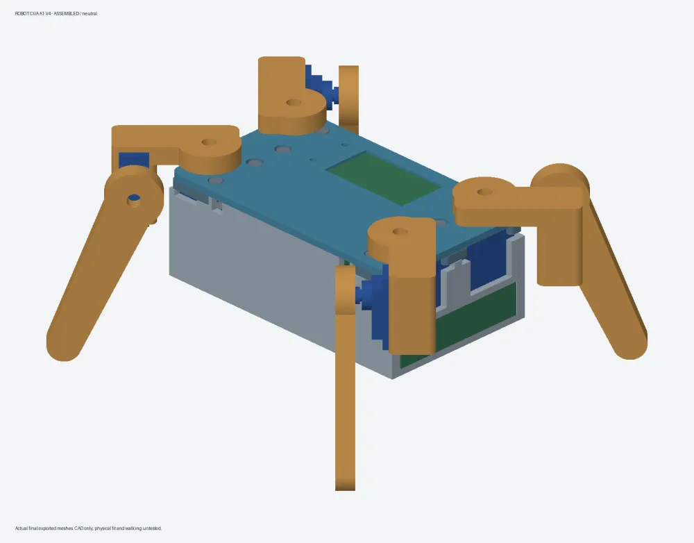
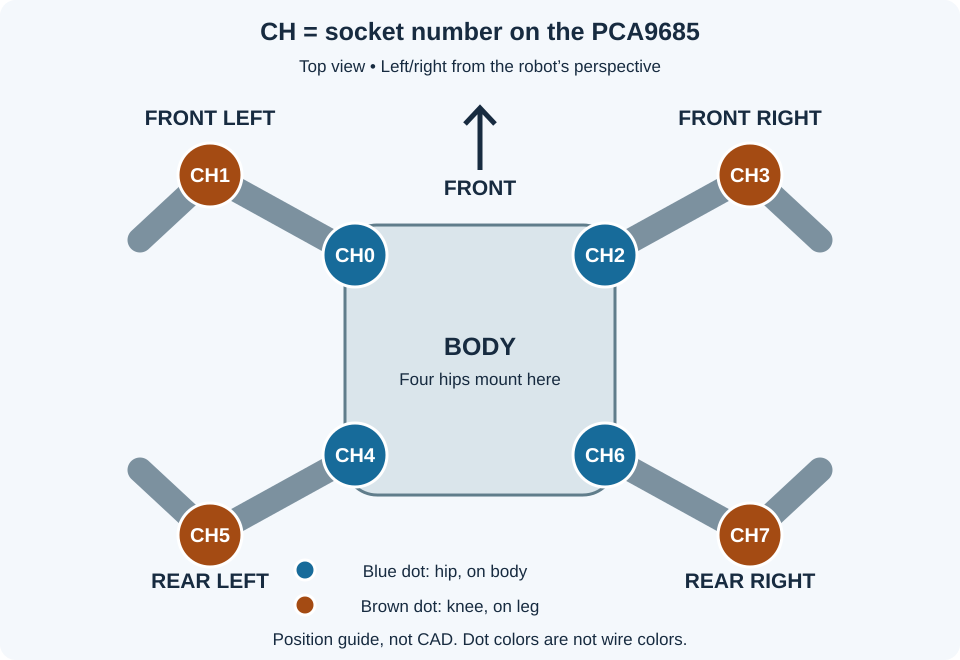
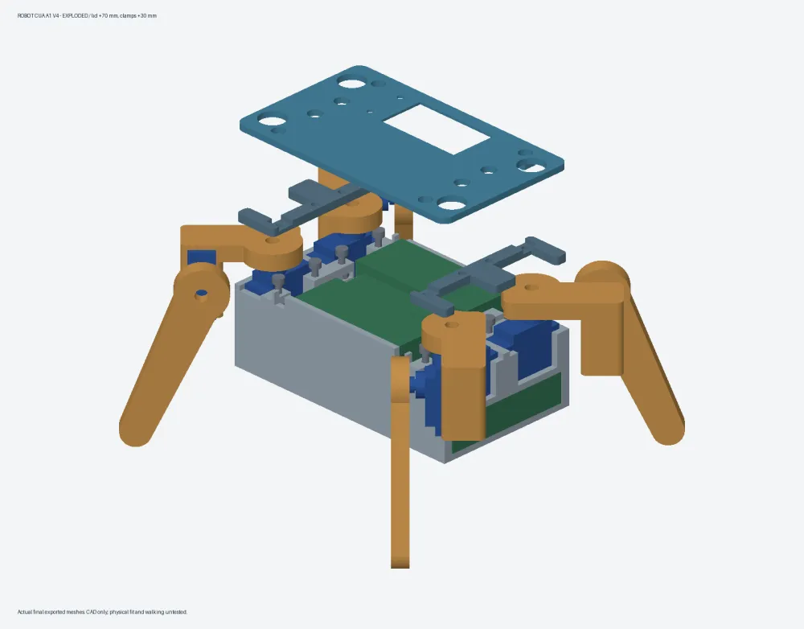
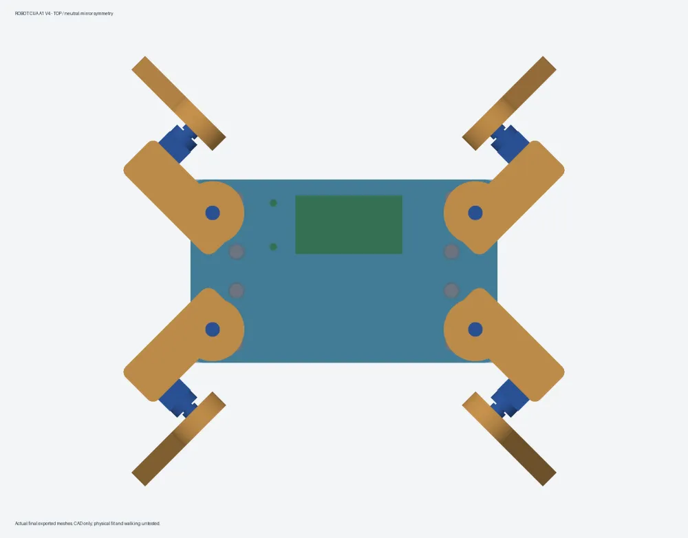
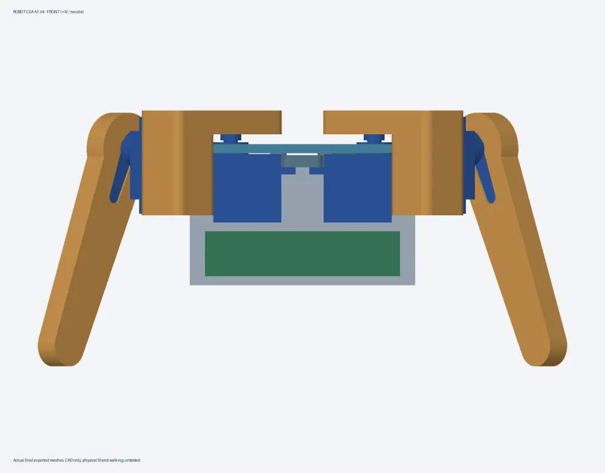
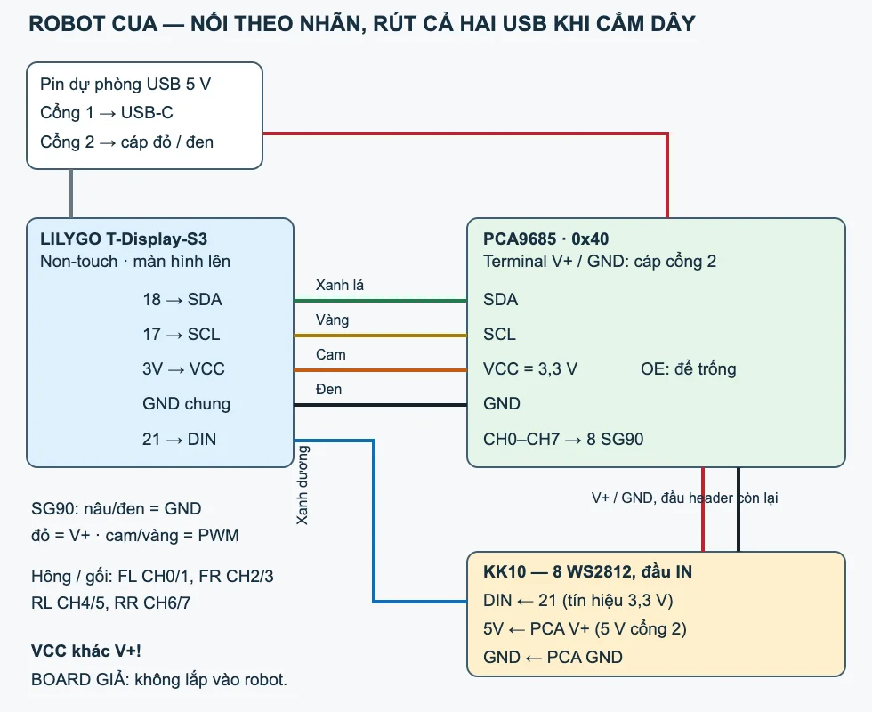
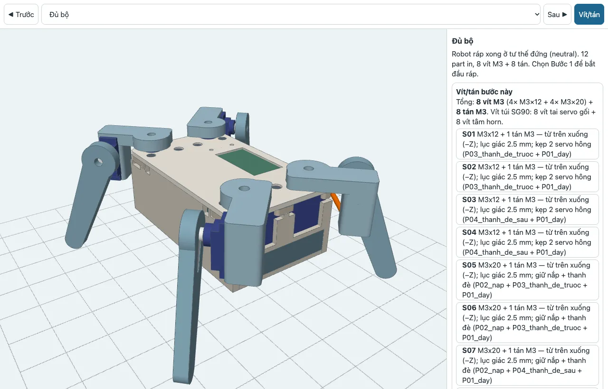
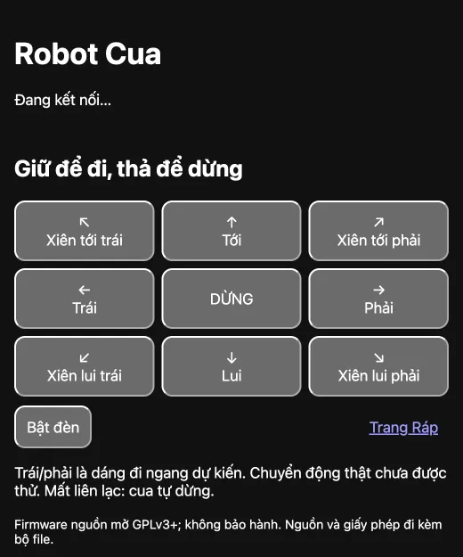

# Crab Robot A1 V4

A four-legged toy crab with eight SG90 servos. Scan a QR code to set up Wi-Fi, then drive it from a web page on your phone. It uses a **LILYGO T-Display-S3 non-touch, PCA9685 servo driver and eight-pixel WS2812 bar**, powered by a two-port 5 V USB power bank. Everything is hand-wired. **The dummy KiCad board must not be ordered or installed in the robot.**

**[BUYING A PCA9685 AND WIRING IT — beginner's guide →](docs/PCA9685-WIRING.md)**

As of 9 November 2026, the owner has confirmed QR display, web access and Wi-Fi scanning on the LILYGO. **The PCA9685 still needs to be purchased.** Servos, LEDs and walking have not been tested. Plate 2 was reported printing; completion and physical fit are unconfirmed. [Status and versions](docs/STATUS.md) · [Tiếng Việt](README.vi.md).

**Check the version before wiring:** this repository contains the 6 November CAD/firmware baseline, shown in the gallery. The skeleton r2 design and newer firmware flashed on 9 November have not been imported into this source tree. **Baseline LED DIN uses GPIO21; the owner's currently flashed board uses GPIO1.** The four PCA connections and CH0–CH7 assignments are the same. Do not overwrite the working board with the baseline just to follow its wiring guide.

## Which PCA9685 should I buy?

Buy **one PCA9685 16-channel I²C servo driver module with all headers and the screw terminal already soldered**. Search for `PCA9685 16 channel servo driver I2C pre soldered`. Look for 16 groups of three pins numbered 0–15, a V+/GND screw terminal and a VCC/GND/SDA/SCL control header. The module type shown in the owner's shop screenshot is correct.

The shop's example connects to an Arduino Uno. For this LILYGO, follow the **printed labels** below:

| LILYGO | PCA9685 |
|---|---|
| 3V / 3V3 | VCC — 3.3 V logic supply |
| G / GND | GND |
| 18 | SDA |
| 17 | SCL |

**VCC and V+ are separate:** power-bank port 2 supplies the servo rail through the PCA's V+/GND screw terminal; port 1 supplies the LILYGO through USB-C. Disconnect both supplies before changing wires. [Full instructions and diagram for the flashed board](docs/PCA9685-WIRING.md).

## What do CH0 and CH1 mean?

**CH is a numbered socket on the PCA9685. Each robot leg has two servos:** the hip servo is mounted on the body and swings the whole leg; the knee servo is mounted on the leg and raises or lowers its lower section. Plug each complete three-wire servo connector into one channel: **brown → GND/−, red → V+/+, orange → PWM/S**. Check the labels on the actual module.

| Robot leg | Hip servo, on the body | Knee servo, on the leg |
|---|---:|---:|
| Front left | CH0 | CH1 |
| Front right | CH2 | CH3 |
| Rear left | CH4 | CH5 |
| Rear right | CH6 | CH7 |

Left and right are from the robot's perspective. Leave CH8–CH15 empty and keep the two spare SG90s aside. Label each connector before assembly.

## Repository baseline gallery

These are CAD renders and interface screenshots, not evidence of an assembled or walking robot. They show the **6 November closed-body baseline**, not skeleton r2.

| | |
|---|---|
|  |  |
| Exploded view: lid and clamp bars lifted | Top view |
|  |  |
| Front view | Baseline LED: GPIO21; currently flashed board: GPIO1 |

 Baseline overview: select a step to see its parts and screws/nuts. Interface text is Vietnamese.

 Hold a direction to move, release to stop. Open the Assembly page to adjust servo centers. Interface text is Vietnamese.

## Assembly and use

1. Check the [BOM: owned, to buy and optional](BOM.md). The LILYGO is already owned; buy a PCA9685 with soldered headers.
2. For the baseline source, print **TEST ONLY + MATING_TEST** first: `case/print/TEST-ONLY-coupons.3mf` is generated by the build. Follow the [assembly checklist, in Vietnamese](CHECKLIST-RAP.md); neither test set has a confirmed physical pass.
3. Follow the [baseline mechanical guide, in Vietnamese](case/README.md) and [fastener map](case/fastener_map.csv). The build creates `case/overview.html`. Baseline body dimensions and screw quantities do not describe skeleton r2.
4. For the currently flashed board, use the [PCA buying and wiring guide](docs/PCA9685-WIRING.md). If building baseline firmware, use its [wiring guide](firmware/WIRING.md) and [build/flash instructions](firmware/README.md), both in Vietnamese. Disconnect servo power before flashing.
5. Scan the Wi-Fi QR, select a 2.4 GHz network and enter its password. If the setup page does not open, visit `http://192.168.4.1/`. After joining the network, scan the web-address QR. Hold BOOT for eight seconds to erase saved Wi-Fi. Support the body with the feet clear before servo tests, and center the servos in the Assembly page before fitting horns.

## Source baseline specifications — 6 November

| Item | Repository baseline |
|---|---|
| Body, excluding legs | 126 × 75 × 47 mm |
| Printed production parts | 12 |
| Screws / nuts | 4 M3×12 + 4 M3×20, 8 M3 nuts; plus screws supplied with SG90s |
| PETG print, Bambu A1 | Two plates, about 4h27 + 2h30; 186.9 g |
| Robot including battery | About 430–440 g, **estimated** |
| CAD checks | ±30°, sampled every 5°; minimum clearance 3.3 mm; symmetry error 0 mm / 0° |

Settings: 0.4 mm nozzle, 0.20 mm layers, two walls, 7% Grid infill and automatic tree supports. These are baseline results, not physical measurements or skeleton r2 figures.

## Assumptions and manual checks

SG90/horn and module dimensions come from references; check the coupon, horn fit and module retention on the real parts. Power-bank limits are 100×65×15 mm, 120 g and at least 2.4 A per port. Actual current, automatic shutoff and assembled weight remain untested. Direct 3.3 V LED data is an **ASSUMPTION**: keep DIN short and next to GND; if it still flickers, disconnect the LED bar and use the robot without it.

Tester notes call for checking servo pockets/horns, wire bends under the boards, QR scanning with the lid fitted, real servo directions, floor grip and power-bank shutoff. Simulation does not prove strength or walking. See the [pass/fail checklist and remedies, in Vietnamese](CHECKLIST-RAP.md). QR/web have been confirmed on the loose board running the newer firmware; the baseline binary has no separate physical confirmation.

## Build from source

Run `./build.sh` in a KiCad Harness environment with KiCad, CadQuery, Bambu Studio, Arduino CLI/core and shared libraries already installed. It does not download or install tools, flash hardware, print or place orders. Order: board and STEP → CAD → plates/3MF → overview/images → firmware/tests. See the [build requirements and validation record, in Vietnamese](BUILD-VALIDATION.md).

Git stores sources, inputs and documentation; generated outputs and caches are ignored. `case/out/`, `case/print/`, `case/overview.html`, `case/images/` and `build/firmware/` appear after a build. Curated README thumbnails are stored separately so they display on GitHub. On another machine, update the library path in `firmware/flash.json` as described in the firmware guide. [CAD source](case/) · [Firmware source](firmware/crab/) · [Original request, in Vietnamese](prompts/original.md).
