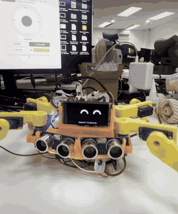
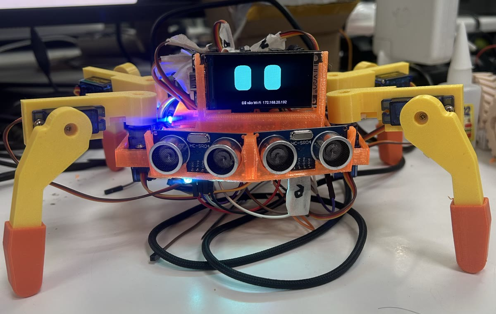
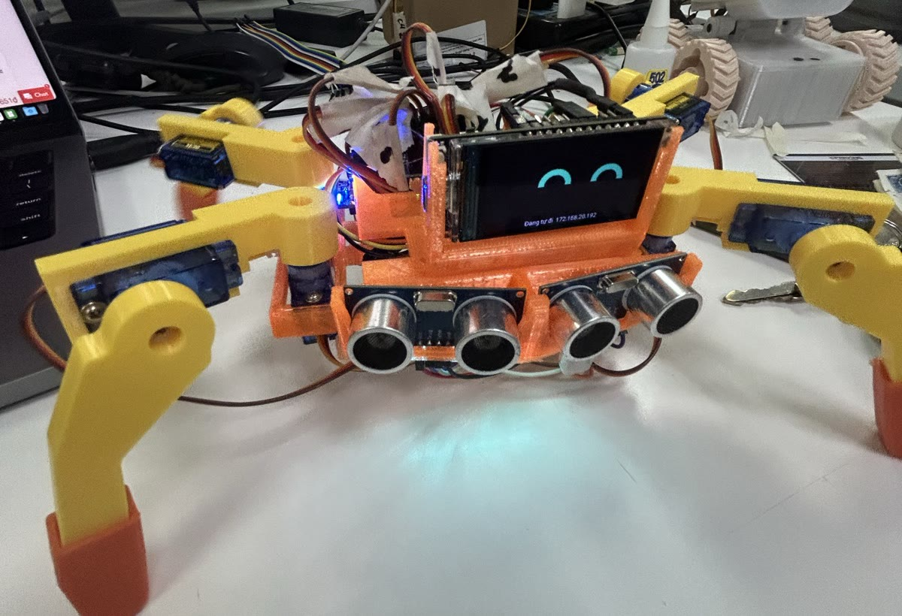
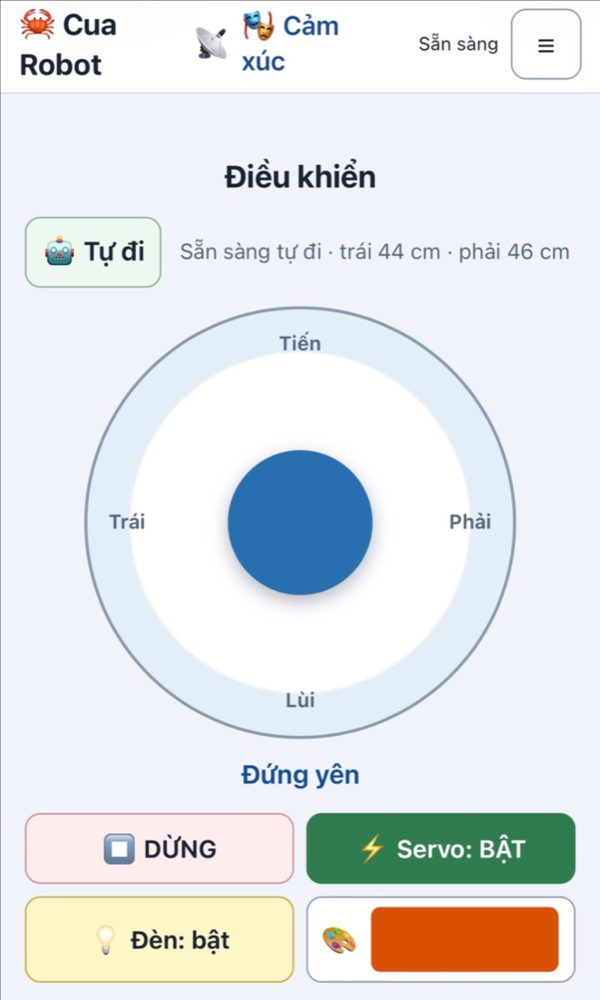
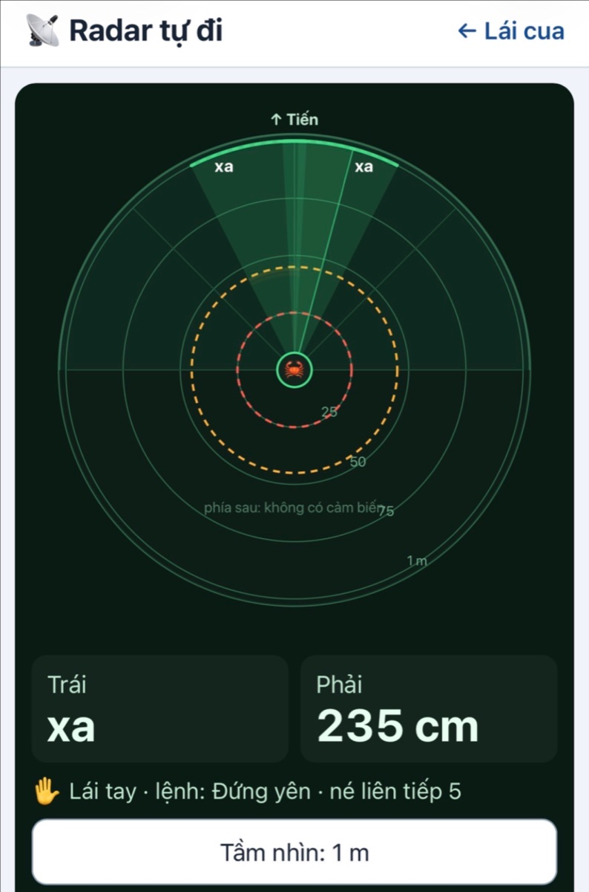

# 🦀 Crab Robot

**A 3D-printed crab with 8 servos and a face. Drive it from your phone, make it dance, or let it roam on its own. Its two sonar eyes see what's ahead, and it spins on the spot to find a way around.**

<p align="center">
  
</p>
<p align="center"><sub>A hand blocks its way. It stops, steps back, spins to a clear path and walks on. Played at 2× speed, firmware v35, 18 Nov 2026. <a href="docs/images/crab-dodge-2026-11-18.mp4">Full video</a></sub></p>

| Front: sonar eyes under the screen | Walking in Tự đi (Auto) with happy eyes |
|---|---|
|  |  |

## What it does

- 🕹️ **Phone joystick.** The crab hosts its own web page over Wi-Fi, so there is no app to install. Drag towards where it should walk, or hold ↺ / ↻ to spin on the spot.
- 🤖 **Tự đi (Auto mode).**
  - It walks by itself and veers away from things on either side.
  - When something blocks the way, it stops with surprised eyes, steps back and spins until both eyes see a free path.
- 📡 **Radar page.** A live view of what both sonar eyes see. The stop and veer distances can be tuned, and the log downloads as CSV.
- 🎭 **Emotions.** Seven built-in moves: happy, sad, angry, hello wave, dance, sleep and surprised. There is also a studio for making your own, saved on the crab.
- 👀 **Living eyes.** They blink, glance around and turn happy while it walks.
- 🎨 **RGB lamp** in any colour.
- 🔄 **Wi-Fi updates.**
  - New firmware goes in over the air, protected by a 6-digit PIN shown on the crab's screen.
  - If the new firmware crashes, the crab rolls back to the old one.
- 🧪 **Tested before flashing.** The gait, autopilot, HTTP API and web pages all run in host tests on a laptop. Nothing is flashed until they pass.

## Drive it from your phone

| Drive page | Radar page |
|---|---|
|  |  |

The pages are in Vietnamese. The [user guide](docs/USER-GUIDE.md) translates every button.

## Build your own

**Parts:**
- LILYGO T-Display-S3 (non-touch)
- PCA9685 servo board
- 8 × SG90 **positional 180°** servos
- 2 × HC-SR04P ultrasonic sensors
- a WS2812 LED strip
- a 1000 µF capacitor
- a 5 V supply: a power bank, or 2 × 18650 cells through a buck converter
- PETG prints: an evening on a Bambu A1

| Step | Guide |
|---|---|
| 🧩 **Assemble**: print, mount the servos and legs, fit the screen stand and sonar head | [Build guide](docs/BUILD.md) |
| 🔌 **Wire**: the LILYGO, the PCA9685, power, sensors and LEDs | [Wiring guide](firmware/WIRING.md) · [one-page wiring card](docs/images/wiring-quick-reference.svg) |
| 🎯 **Calibrate**: centre the servos, then trim each leg | [Calibration](docs/USER-GUIDE.md#calibration-ráp) |
| 🚀 **Flash and drive** | [Firmware](firmware/README.md) · [User guide](docs/USER-GUIDE.md) |

## Quick start

1. Power it on. The servos arm one at a time and the crab stands up.
2. Join the network shown on its screen: your Wi-Fi, or the crab's own **`CuaRobot-XXXX`**. Then open the address it shows, for example **http://192.168.4.1/**.
3. Drive with the joystick, or tap **🤖 Tự đi** and let it roam.

## Firmware

- **Running now:** `positional180-v35`, target `lilygo`, which adds spin on the spot and spin-to-search Auto mode.
- History and flashing: [firmware/README.md](firmware/README.md).

```sh
python3 tools/firmware/check.py                 # host tests, no hardware touched
python3 tools/firmware/build.py --target all    # build both targets, nothing flashed
python3 tools/firmware/ota_push.py --host <crab-ip> --bin build/firmware/esp32/crab.ino.bin
```

## More docs

| Looking for | Open |
|---|---|
| Every button, slider and setting; troubleshooting | [docs/USER-GUIDE.md](docs/USER-GUIDE.md) |
| Assembly, printed parts | [docs/BUILD.md](docs/BUILD.md) · [case/README.md](case/README.md) · [printed parts list](case/PRINTED-INVENTORY.md) |
| Front sonar head · screen stand · rotating sonar turret (optional) | [sonar_front](case/sonar_front/README.md) · [screen_stand](case/screen_stand/README.md) · [sonar_turret](case/sonar_turret/README.md) |
| Sensors, Auto mode and battery power | [firmware/BATTERY-AUTONOMY.md](firmware/BATTERY-AUTONOMY.md) |
| Gaits · web controls · emotions | [CRAWL](firmware/CRAWL.md) · [WEB-CONTROL](firmware/WEB-CONTROL.md) · [EMOTIONS](firmware/EMOTIONS.md) |
| Integrated ESP32-S3 + PCA9685 board (designed, not built yet) | [docs/INTEGRATED-CONTROLLER.md](docs/INTEGRATED-CONTROLLER.md) · [KiCad sources](design/) |
| 360° servo trials (didn't work out) | [firmware/EXPERIMENT-STATUS.md](firmware/EXPERIMENT-STATUS.md) |
