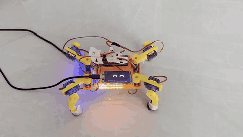
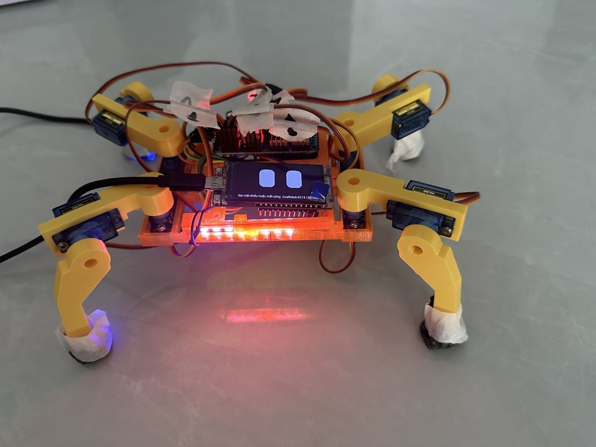
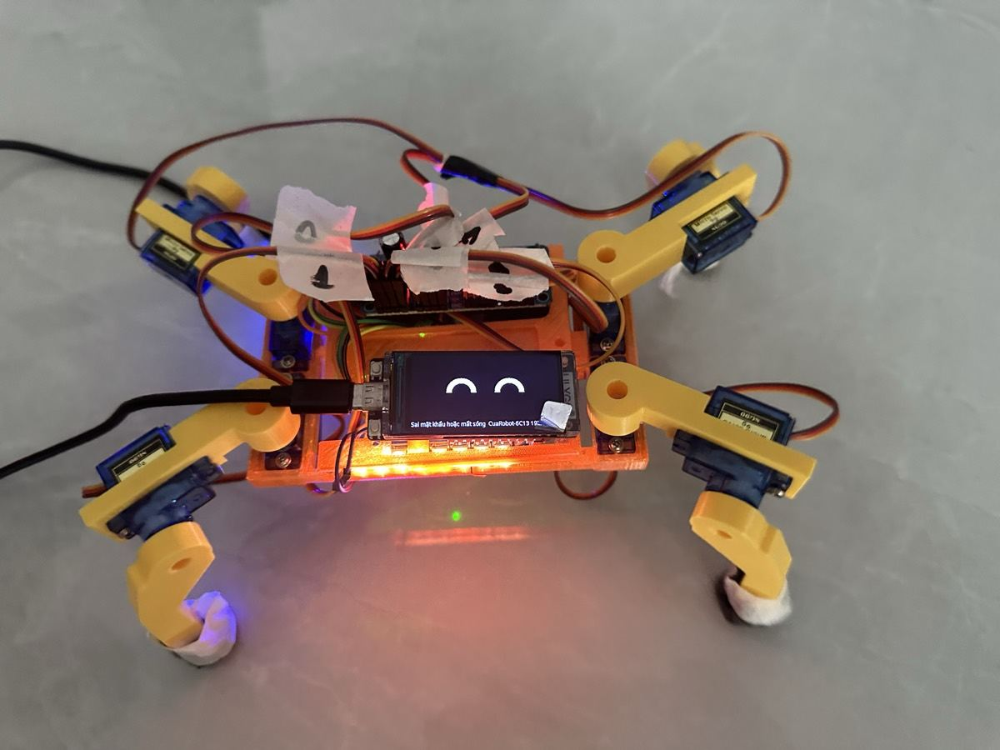
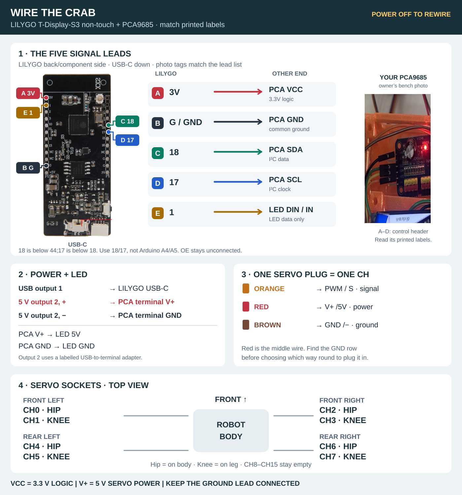

# 🦀 Crab Robot

**An 8-servo crab whose face is a screen with two eyes. Drive it from your phone, play emotions, change the lamp colour.**

[Drive](#open-the-controls) · [Gaits](#gaits-and-sliders) · [Emotions](#emotions) · [Calibration](#calibration-ráp) · [Servo channels](#which-servo-goes-where) · [Wiring](#wiring) · [Firmware](#firmware)

<p align="center">
  
</p>

| Idle: eyes open, blink, glance | Walking: happy eyes ^ ^ |
|---|---|
|  |  |

*Photos and video by the owner, 14 Nov 2026, firmware `positional180-v19`.*

The web controls are in Vietnamese. Button names below are quoted as they appear on screen, with the English meaning next to them.

## What's on the crab

| Part | How to spot it | Job |
|---|---|---|
| **LILYGO T-Display-S3** (non-touch) | Black board with the screen and USB-C port | Wi-Fi, web controls, the eyes |
| **PCA9685** | Blue board with 16 rows of 3-pin headers | Servo pulses for CH0–CH7 |
| **8 × SG90 positional 180°** | 4 hips on the body, 4 knees on the legs | Joints. **Do not use 360° continuous servos** |
| **WS2812 strip ×8** | Thin strip with 8 LEDs | Colour lamp |
| **Separate 5 V servo supply** | Into the PCA `V+` / `GND` screw terminal | Powers servos and LEDs; kept apart from the LILYGO's USB |

## Open the controls

1. Power it on. The servos **arm themselves** one channel at a time over about 3 seconds, then the crab stands up. Keep fingers out from between the legs.
2. Read the **small line at the bottom of the screen**:
   - On home Wi-Fi: the line shows the address, e.g. `Đã vào Wi-Fi  192.168.x.x` ("joined Wi-Fi"). Open that address on a phone on the same network.
   - Not on home Wi-Fi: join the crab's own network **`CuaRobot-XXXX`** (no password) and open **http://192.168.4.1/**.
   - Never saved a Wi-Fi network: the screen shows a QR code to join quickly.
3. Hold a button to walk, release to stop: **↑ Tiến** (forward) · **← Trái** (left) · **Phải →** (right) · **↓ Lùi** (back). If the link drops, the crab stops within 0.5 s.
4. To forget the saved Wi-Fi, hold **BOOT** for about 8 seconds.

On the phone, tap **☰** for settings. The **Trạng thái** (status) tab lists firmware, PCA9685, servos, gait, speed, lamp and Wi-Fi.

## Gaits and sliders

| Gait | How it moves | When to use it |
|---|---|---|
| **Chéo** (diagonal, default) | Diagonal leg pairs push in turn, with moments where all 4 feet are down | Steady, doesn't spin. The owner's favourite |
| **Cặp trước/sau** (front/rear pairs) | Front pair pushes, then the rear pair | Old gait, kept for comparison. Sideways walking rotates the body |
| **Búng gối** (knee flick, experimental) | Forward/back: hips swing out (front legs forward, rear legs back), then all 4 knees flick. Left/right still uses the diagonal gait | Experiments |

Sliders in the settings panel:

| Slider | Range | Saved on the crab? | Use it when |
|---|---|---|---|
| **Tốc độ** (speed) | 20–100%, default 90% | No (back to 90% at boot) | You want to walk slowly to watch |
| **Độ nhấc gối** (knee lift) | 20–60°, default 45° | Yes | Feet drag on the table while the hips swing back: raise it |
| **Bù lệch trái ↔ phải** (heading trim) | −30 … +30% | Yes | Drifts right walking forward: move towards **+**; drifts left: towards **−** |
| **Góc hông búng** (flick hip angle) | 30–90°, only shown for Búng gối | No | Legs touch each other: lower it |
| **Lamp colour** | Colour picker next to **Bật / tắt đèn** (lamp on/off) | Yes | Changes the LED strip colour |

Angles on the page are **nominal command angles**, not measured ones. On the usual SG90 scale, 1° nominal is about ½° real.

## Emotions

Tap **🎭 Cảm xúc** at the top of the main page, or open `/emo`.

- **7 built-in emotions:** 😄 happy, 😢 sad, 😡 angry, 👋 hello, 💃 dance, 😴 sleep, 😲 surprised. Each has its own lamp colour.
- **Make your own:** drag a leg's Hip/Knee sliders and the crab follows live. Tick **Đối xứng trái/phải** (mirror left/right) to make both sides match. Add frames, set move/hold times, name it and tap **Lưu vào cua** (save to crab).
- **Slider direction:** Hip **+** moves the foot forward. Knee **+** lifts the leg, **−** pushes down (body goes up).
- **Safety:** leaving the page or losing the link returns the crab to its standing pose, slowly at 120°/s.

## The eye screen

Two white eyes on black, drawn from shapes in the style of the Claude pet:

- **Idle:** blinks every 2.5–5.5 s and glances left/right now and then.
- **Walking or playing an emotion:** happy eyes ^ ^.
- **Bottom line:** Wi-Fi state and address. PCA9685 wiring errors show here too.

## Calibration (Ráp)

Open **☰ → Ráp** (assembly). Assembly mode locks the drive buttons.

1. Tap **Tư thế đứng** (standing pose).
2. For each hip, tap **±3** until the leg sits at an even diagonal, then fine-tune with **±1**. A ±1 step is close to the SG90 deadband, so the servo may not move on the first tap.
3. For each knee, adjust until all 4 feet touch the floor and the body is level.
4. Tap **Lưu tâm** (save centres), then **Xong ráp** (done). Without Lưu tâm the trims are lost at reboot.

Trims max out at ±30°. If a channel is at ±30°, pull the horn off and refit it one spline over (about 14°) to bring the trim back near 0.

Replacing a servo:
1. Unplug the 5 V supply and remove the horn.
2. Plug it back in, go to **Ráp → Giữa thô · 1500 µs** (rough centre), wait about 3 seconds.
3. Fit the horn so the leg sits on the diagonal.
4. Set that channel's trim back to 0, tune it again, then **Lưu tâm**.

## Which servo goes where?

**One servo = one 3-wire plug = one CH socket.** Hips sit on the body, knees on the legs. Leg names on the Ráp and Cảm xúc pages follow this table:

| Leg | Hip | Knee |
|---|---|---|
| Front left | **CH0** | CH1 |
| Front right | **CH2** | CH3 |
| Rear left | **CH4** | CH5 |
| Rear right | **CH6** | CH7 |

> ⚠️ **Walking direction and leg names are set separately.** The owner turned the crab around, so **Tiến** (forward) walks towards the **CH4/CH6** end (`cfg::FRONT_IS_CH46 = true` in `firmware/crab/config.h`). If forward/back/left/right are all reversed, flip that constant and reflash.

At each socket: **orange → `PWM`/`S`**, **red (middle) → `V+`**, **brown → `GND`/`−`**. Check the GND label printed on the board before plugging in. Leave CH8–CH15 empty.

## Wiring

**Unplug both supplies before changing any wire.**

[](docs/images/wiring-quick-reference.svg)

| Lead | LILYGO pin | Other end |
|---|---|---|
| **A** | `3V` | PCA **`VCC`**, 3.3 V logic |
| **B** | `G` / `GND` | PCA **`GND`** |
| **C** | `18` | PCA **`SDA`** |
| **D** | `17` | PCA **`SCL`** |
| **E** | `1` | LED **`DIN`** |

**Power:**
- **USB:** into the LILYGO's USB-C. Use a data cable when flashing.
- **Separate 5 V:** into the PCA terminal, positive to **`V+`**, negative to **`GND`**.
- **LEDs:** powered from the PCA's servo-side **`V+`/`GND`**.

**`VCC` is 3.3 V logic; `V+` is the 5 V servo supply. Never join them, and never power servos from the LILYGO.** Close-up photos and troubleshooting are in the [wiring guide](firmware/WIRING.md).

## Saving and restoring settings

The owner's tuned settings are in [`firmware/settings/owner-2026-11-13.json`](firmware/settings/owner-2026-11-13.json): trims for all 8 channels, speed, knee lift, heading trim, flick hip angle, gait and lamp colour.

After wiping the flash or swapping the board, restore them with:

```sh
python3 tools/firmware/restore_settings.py firmware/settings/owner-2026-11-13.json --host <crab-ip>
```

Add `--dry-run` to preview the requests. The script needs all 8 servos armed, and it takes control away from any open web page (reload the page afterwards).

## Firmware

- **Running now:** `positional180-v19`, target **`lilygo`**. The **`integrated`** target is for the future integrated board.
- **Build, flash and version history:** [firmware/README.md](firmware/README.md). See also [gaits](firmware/CRAWL.md), [web controls](firmware/WEB-CONTROL.md) and [emotions](firmware/EMOTIONS.md).

```sh
# Host-side tests (don't touch the crab)
python3 tools/firmware/check.py core web drivers display http targets
python3 tools/firmware/test_restore_settings.py

# Build both targets (no flashing, no motors)
python3 tools/firmware/build.py --target all
```

Building doesn't flash a board, run motors, print or order anything.

## Known issues

- **The bottom screen line gets cut off when it's long.** For example, after a Wi-Fi failure `Sai mật khẩu hoặc mất sóng  CuaRobot-XXXX 192.168.4.1` ("wrong password or no signal") doesn't fit on one line.
- **Speed, gait and flick hip angle aren't saved on the crab.** A reboot brings back the defaults: 90%, Chéo, 90°.
- **Walking direction and leg names are set separately** (see the warning under [servo channels](#which-servo-goes-where)). Built-in emotions and the heading trim may feel "back to front" relative to Tiến.
- **A USB cable dragging behind** can pull the crab off course. A power bank mounted on the body walks straighter.
- **Knee flick at 90° goes past the body's old clearance** (30/60°). On the first run, watch for legs hitting each other.

## More docs

| Looking for | Open |
|---|---|
| Printed parts, assembly, body edits | [case/README.md](case/README.md) · [printed parts list](case/PRINTED-INVENTORY.md) |
| Integrated ESP32-S3 + PCA9685 board | [docs/INTEGRATED-CONTROLLER.md](docs/INTEGRATED-CONTROLLER.md) · [KiCad sources](design/) |
| Build-from-source results | [BUILD-VALIDATION.md](BUILD-VALIDATION.md) |
| 360° servo trials (didn't work out) | [firmware/EXPERIMENT-STATUS.md](firmware/EXPERIMENT-STATUS.md) |
