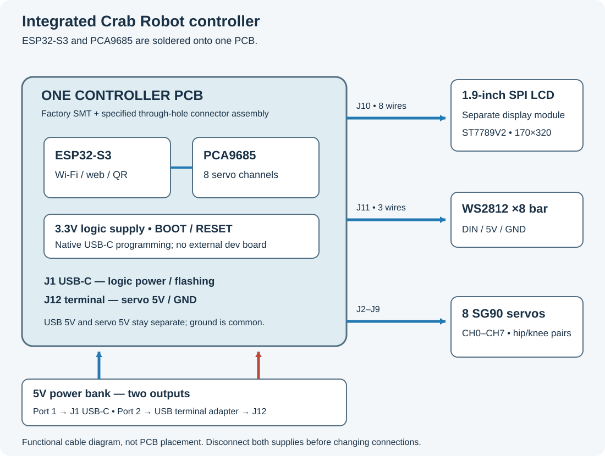

# Crab Robot — integrated controller and open skeleton

One **88 × 62 mm custom PCB** contains the ESP32-S3-WROOM-1-N16R8, PCA9685 servo controller, 3.3 V regulator, native USB-C and BOOT/RESET buttons. Eight SG90 servos, a small cabled Waveshare LCD, LED stick and an ordinary closed USB power bank complete the robot. This is the integrated hardware branch; the original modular build remains on `main`.

The new body has **two open bar frames** and individual servo-tab mounts. It reuses the four thighs and four feet already printed. The two interfering clamp bars are retired. Skin is deferred until the owner asks for it.



## Using the LILYGO and PCA9685 you already have?

Start with the **[original-module wiring guide](firmware/WIRING.md#original-lilygo-and-bought-pca9685)**. The owner reports that the PCA9685 breakout has arrived. That build uses four logic wires: **3V→VCC, GND→GND, GPIO18→SDA, GPIO17→SCL**. The pinout picture also labels GPIO18/17 as U1RXD/U1TXD; those are alternate functions, while this firmware assigns them to I²C. CH0–CH7 are servo sockets on the PCA, not ESP32 GPIO numbers.

The custom-PCB J2–J12 tables below describe the future integrated variant. Keep using the LILYGO firmware for the currently owned modules.

## Start here

1. Read [what to buy after ordering the PCB](docs/AFTER-ORDER.md) and [the PCBA quotation guide](docs/PCB-ORDERING.md). Factory SMT assembly plus the through-hole service avoids fine-pitch soldering at home.
2. Follow [the illustrated integrated wiring guide](docs/INTEGRATED-WIRING.md). Port 1 of the bank powers USB-C logic; port 2 powers the servo/LED terminal. Their positive rails stay separate; ground is shared on the PCB.
3. Use [the correct firmware target](docs/INTEGRATED-FIRMWARE.md). The integrated board and the original LILYGO have separate binaries and pin configurations.
4. Use [the mechanical assembly guide](case/README.md), [BOM](case/BOM.md) and [physical checks](case/CHECKLIST-RAP.md). The generated overview uses one eight-step assembly sequence, with the real parts, screws and wire paths.

## What it does

On first start the LCD displays a setup QR. Connect a phone, choose Wi-Fi and enter its password, then open the web controller. The firmware implements driving directions, speed, LED control and servo-centre/trim controls. Hold the running application's BOOT button for eight seconds to return to setup.

The USB-C connector is on the PCB's **+Y side**, where an ordinary data cable can pass through the open frame. The display mount preserves its 180° orientation and leaves room for its mating plug and all eight wires. Each servo lead has alternative open routes; long routes may need an extension rather than a stretched cable.

## Existing prints and owner feedback


This is the owner's **previous orange body**, with eight servos and four yellow legs mechanically installed. The owner hand-made four wire openings, removed both interfering clamp bars and used direct hip-tab screws. It is not a print or test of the new frame or integrated PCB. [The chronological photo record](references/OWNER-PRINTS.md) preserves what was printed, removed and modified, including the unknown source revision and screw/hole details.

For the new frame, the generated **Print all** file retains the complete ten-part assembly on two named plates. Plate 1 is the two new frames; plate 2 is the eight existing leg parts to keep. Try the separate **TEST ONLY** saddle coupon with one real servo before a long print. Generated plate estimates and validation are recorded in [BUILD-VALIDATION.md](BUILD-VALIDATION.md).

## Prototype status and hands-on work

Read the current source-build result in [BUILD-VALIDATION.md](BUILD-VALIDATION.md). Native electrical/manufacturing checks, CAD checks and firmware host tests are desktop evidence. The new PCB has not been manufactured, powered or flashed; the new frame has not been printed or physically fit-tested. The earlier successful QR setup was on the LILYGO board. No new-board walking, temperature, radio-range or servo-load result is claimed.

Check the **three servo-screw types** before assembly: sixteen tab screws, eight horn-arm screws and eight centre screws. Spare centre screws do not replace missing horn-arm screws. The mechanical list provides at least eleven thin zip ties, plus bank retention. Ask the assembler to include the eleven through-hole connectors (**37 PCB joints**) if the PCBA quote covers only SMT.

The first prototype still needs inspection of soldering/mounting insulation, servo/horn fit, cable slack, frame strength, QR visibility, Wi-Fi range, bank shutoff/surges and floor grip. Direct 3.3 V WS2812 data remains an actual-light-bar check. For the owner's current drilled body, inspect rough wire-hole rims, screw holes and servo tabs before power; see the physical checklist.

## Build from source

```sh
./build.sh
```

Use the documented macOS toolchain: KiCad 10.0.5, CadQuery 2.7.0/OCP 7.8.1.1, Bambu Studio CLI, Arduino CLI with ESP32 core 2.0.14, Pillow, clang/clang++, Node and Swift/Vision. Set `KICAD_HARNESS_PYTHON` and `KICAD_CASE_PYTHON` to the supplied interpreters. The first build fetches hash-pinned manufacturer references into an ignored cache. It reports missing dependencies and installs no software.

Build order: model/source preparation → native board/STEP/manufacturing exports → source-recreated frozen parts → case, complete lead-motion/access checks and arranged plates → standalone assembly overview → both firmware targets, native-board reconciliation and host/QR tests → complete release and freshness checks. Authored copper remains the board source.

After a successful build, open `case/overview.html`, `case/print/production.3mf` and the manufacturing packet under `boards/`. STL/STEP/3MF/Gerbers, reports, binaries and rendered views are regenerated outputs and are intentionally outside Git. The build does not flash, operate a printer or place an order.

[Native KiCad sources](design/) · [Engineering](engineering/) · [Firmware](firmware/crab/) · [Case sources](case/)
