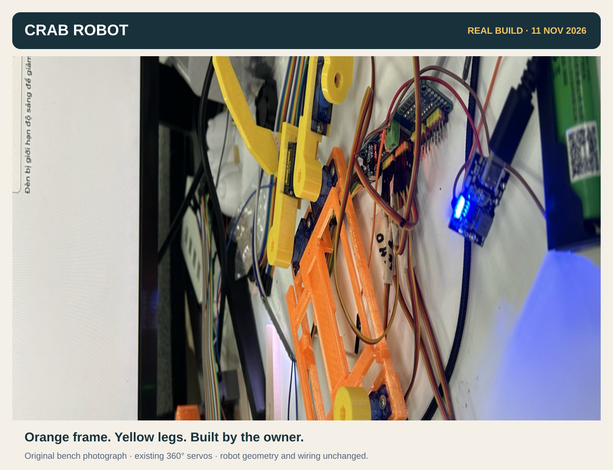

# Crab Robot

**A small, open-frame crab toy. Connect to its Wi-Fi, open the controller, switch on the lights.**

[Wire it](#wire-it) · [Servo sockets](#which-servo-goes-where) · [Open the controller](#open-the-controller) · [Current status](#current-status) · [Firmware & CAD](#source-and-future-hardware)



*The real bench assembly, photographed on 11 November. The photo shows the existing continuous-rotation servos; replacement positional servos have not been confirmed received.*

## What is on this robot?

| Part | Recognise it | Job |
|---|---|---|
| **LILYGO T-Display-S3, non-touch** | Black board, built-in screen and USB-C | Wi-Fi, QR screen and web controller |
| **PCA9685 breakout** | Blue board, green screw terminal, sixteen groups of three pins | Eight servo sockets, CH0–CH7 |
| **8 × SG90-class servos** | Four body-mounted hips and four knees carried on the legs | Joint motion; this mechanism needs **positional** servos |
| **WS2812 LED stick ×8** | Thin bar with eight square LEDs | Light controlled from the web page |
| **Separate 5 V servo supply** | Plugs into PCA terminal `V+` and `GND` | Servo and LED power; separate from LILYGO USB power |

The wiring below is for these **separate modules**. The [future integrated PCB](docs/INTEGRATED-CONTROLLER.md) has its own connectors and wiring guide.

## Wire it

**Unplug both supplies before changing wires.** Keep this sheet beside the robot: the board photo, five signal leads, power, servo-plug colours and channel map are together.

[](docs/images/wiring-quick-reference.svg)

<details>
<summary><strong>Text version: the same wires, power and LED connections</strong></summary>

**Match the letters A–E on the photo:**

| Lead | LILYGO pin | Other end | Suggested colour |
|---|---|---|---|
| **A** | `3V` | PCA **`VCC`** — 3.3 V logic | Red |
| **B** | `G` / `GND` | PCA **`GND`** | Black |
| **C** | `18` | PCA **`SDA`** | Green |
| **D** | `17` | PCA **`SCL`** | Blue |
| **E** | `1` | LED **`DIN` / `IN`** | Yellow |

`18` and `17` are on the right in the **back/component-side view with USB-C down**. `18` is immediately below `44`; `17` is immediately below `18`. The `U1RXD` / `U1TXD` names in a pinout are alternate functions: this firmware uses these pins for I²C.

**Two power connections:**

- **USB output 1 → LILYGO USB-C**, using a data-capable USB cable when flashing.
- **Separate 5 V output → labelled USB-to-terminal adapter → PCA screw terminal:** positive to **`V+`**, negative to **`GND`**. The B ground lead must also stay connected.
- **LED power:** PCA servo-side **`V+` → LED `5V`** and **`GND` → LED `GND`**. Lead E carries only LED data. Follow the arrow into the LED stick's input end.

**`VCC` is 3.3 V logic. `V+` is 5 V servo power.** Do not bridge them or power the eight servos through LILYGO. Use printed `+`/`−` labels on the screw terminal; left/right can change when the board is turned over. Leave PCA `OE` unconnected on this reference breakout.

Use female-to-female Dupont leads for A–E. These colours are a suggestion; the label at each end decides the connection. For close-up photos, assembly order and fault fixes, open the [step-by-step wiring guide](firmware/WIRING.md#original-lilygo-and-bought-pca9685).


</details>

## Which servo goes where?

**One servo = one complete three-wire plug = one CH socket.** A hip sits on the body; a knee sits on the leg. Mark **FRONT** on the body and use this top view; robot left/right stay fixed when you walk around it.

```text
                         FRONT ↑

      FRONT LEFT                       FRONT RIGHT
      Hip  → CH0                       Hip  → CH2
      Knee → CH1                       Knee → CH3
                ┌──────────────────┐
                │    ROBOT BODY    │
                └──────────────────┘
      REAR LEFT                        REAR RIGHT
      Hip  → CH4                       Hip  → CH6
      Knee → CH5                       Knee → CH7
```

At every socket: **orange → `PWM` / `S`**, **red → `V+`**, **brown → `GND` / `−`**. Red is the middle wire. Check which outer row is labelled GND before plugging in. Keep CH8–CH15 empty; two spare servos remain loose.

## Open the controller

1. Power the LILYGO by USB. Scan its screen QR, join **`CuaRobot-XXXX`**, and choose to stay connected if the phone reports no internet.
2. Open **http://192.168.4.1/** in the browser. The interface is Vietnamese: **Lái cua** = controller, **Wi-Fi** = optional home-network setup, **Ráp** = assembly/trim.
3. Use **Bật / tắt đèn** for the light. Home Wi-Fi is optional; connecting to the crab directly is enough. After joining a home network, the screen gives that network's robot address.
4. Hold the running application's **BOOT** button for about eight seconds to forget saved Wi-Fi. BOOT/reset does not disconnect servo power.

## Current status

| Working or observed | Still waiting for a physical check |
|---|---|
| Owner opened the QR/web controller; individual servo direction tests worked | Replacement **180° positional** servos, actual fit and loaded torque |
| Firmware includes direct AP access and the independent light switch | Servo supply capacity, loaded stopping and stable walking |
| Firmware starts with servo PWM off and capped-brightness LEDs on | The future integrated PCB and matching new frame |

**The two loaded 360° trials did not work reliably.** The first timed crawl caused leg collisions; the following hips-only trial moved erratically. The checked-in Forward/Backward experiment is retained for reference and is **not a demonstrated walking mode**. Equal reverse time cannot restore an accurately known joint angle. Read [the experiment record](firmware/EXPERIMENT-STATUS.md).

This jointed-leg mechanism needs **eight positional servos**. Positional replacements are awaited. When parts arrive, test one unloaded motor's position response and fit before replacing the whole set. Recheck centre, direction and cable slack during assembly. The existing timed 360° controls are not the setup procedure for replacement positional motors.

### Hands-on checks that remain

- Identify the actual servo variant and test one motor before attaching a leg.
- Confirm the 5 V supply and screw-terminal polarity. A power LED alone does not establish adequate servo power.
- Check the owner's hand-cut wire openings, direct servo-tab screws, horn fit and free joint motion with power disconnected.
- The future frame still needs first-print fit checks. Its full case build has an outstanding official-checker intent/manual-review step; see [build validation](BUILD-VALIDATION.md).

## Source and future hardware

| Looking for | Open |
|---|---|
| Photo wiring instructions for the existing robot | [Wiring guide](firmware/WIRING.md) |
| Build/flash instructions and two firmware targets | [Firmware README](firmware/README.md) |
| Exact status of the 360° experiments | [Experiment record](firmware/EXPERIMENT-STATUS.md) |
| Printed parts, assembly and owner modifications | [Assembly guide](case/README.md) · [Printed inventory](case/PRINTED-INVENTORY.md) |
| Source-build results and outstanding full-build step | [Build validation](BUILD-VALIDATION.md) |
| Future ESP32-S3 + PCA9685 custom board | [Integrated controller](docs/INTEGRATED-CONTROLLER.md) · [Native KiCad sources](design/) |

The current module build uses the **`lilygo`** firmware target. The **`integrated`** target is for the future custom PCB and uses a different display interface. Building does not flash a board, move motors, start a print or place an order.

```sh
# Regenerate/check the complete project; read the outstanding manual step first.
./build.sh
```

Photos are the owner's supplied references. Diagram pin assignments come from [firmware hardware.h](firmware/crab/hardware.h), cross-checked against the [LILYGO reference](https://github.com/Xinyuan-LilyGO/T-Display-S3) and [PCA9685 pin definitions](https://learn.adafruit.com/16-channel-pwm-servo-driver/pinouts). GPIO 1 → LED data at 3.3 V remains an actual-stick compatibility assumption. Historical exposed-cell/module photos document the bench, not a verified power solution; this guide uses a closed 5 V USB supply.
