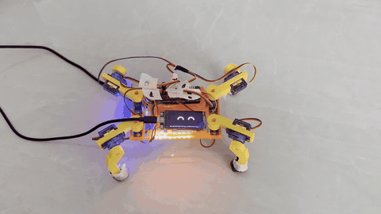
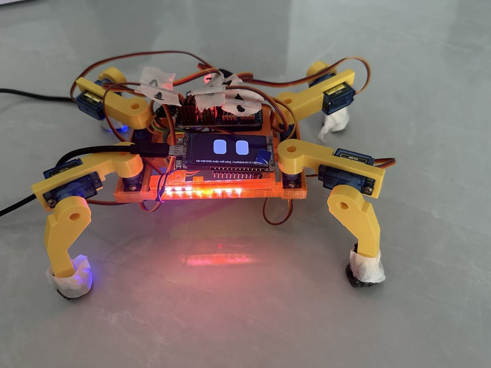
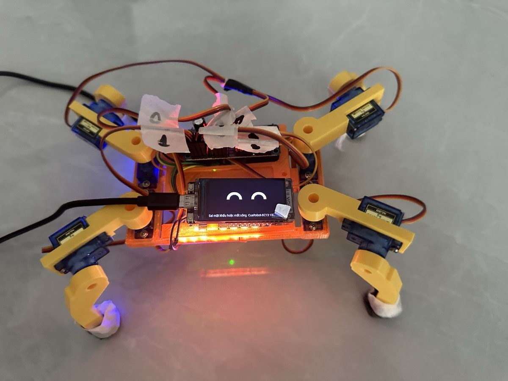

# 🦀 Crab Robot

**An 8-servo crab whose face is a screen with two eyes. Drive it from your phone, or let it walk by itself and dodge obstacles. Play emotions, change the lamp colour.**

[Drive](#open-the-controls) · [Tự đi (Auto)](#tự-đi-auto-mode) · [Radar](#radar-page) · [Gait](#gait-and-sliders) · [Emotions](#emotions) · [Calibration](#calibration-ráp) · [Servo channels](#which-servo-goes-where) · [Wiring](#wiring) · [Firmware](#firmware)

<p align="center">
  
</p>

| Idle: eyes open, blink, glance | Walking: happy eyes ^ ^ |
|---|---|
|  |  |

*Photos and video by the owner, 14 Nov 2026, firmware `positional180-v19`.*

### Drive it from your phone 📱

| Drive page: joystick, 🤖 Tự đi, lamp colour | Radar page: what the two sonar eyes see |
|---|---|
|  |  |
| One thumb drives: drag towards where the crab should walk, let go to stop. The line by **Tự đi** shows both sonar distances live. | Live sonar picture at 5 Hz. Red and orange rings are the stop and veer distances, adjustable on the same page, with a log you can download. |

*Screenshots by the owner, 17 Nov 2026, firmware `positional180-v32`, on the crab's own Wi-Fi.*

The web controls are in Vietnamese. Button names below are quoted as they appear on screen, with the English meaning next to them.

## What's on the crab

| Part | How to spot it | Job |
|---|---|---|
| **LILYGO T-Display-S3** (non-touch) | Black board with the screen and USB-C port | Wi-Fi, web controls, the eyes |
| **PCA9685** | Blue board with 16 rows of 3-pin headers | Servo pulses for CH0–CH7 |
| **8 × SG90 positional 180°** | 4 hips on the body, 4 knees on the legs | Joints. **Do not use 360° continuous servos** |
| **WS2812 strip ×8** | Thin strip with 8 LEDs | Colour lamp |
| **2 × HC-SR04P** (fitted 2026-11-17) | Four round "eyes" in one row on the front sonar head, under the screen | Obstacle sensing for **Tự đi** (Auto) and the radar page |
| **One 5 V supply** | Into the PCA `V+` / `GND` screw terminal, with a 1000 µF capacitor across it | Powers servos, LEDs and (through lead F) the LILYGO. It can be a power bank, or [2 × 18650 cells through the LM2596](firmware/BATTERY-AUTONOMY.md#battery-now-with-parts-already-owned) |

## Open the controls

1. Power it on. The servos **arm themselves** one channel at a time over about 3 seconds, then the crab stands up. Keep fingers out from between the legs.
2. Read the **small line at the bottom of the screen**:
   - On home Wi-Fi: the line shows the address, e.g. `Đã vào Wi-Fi  192.168.x.x` ("joined Wi-Fi"). Open that address on a phone on the same network.
   - Not on home Wi-Fi: join the crab's own network **`CuaRobot-XXXX`** (no password) and open **http://192.168.4.1/**.
   - Never saved a Wi-Fi network: the screen shows a QR code to join quickly.
3. Drive with the round **joystick** (since v31), [screenshot above](#drive-it-from-your-phone-):
   - Press the knob and drag towards where the crab should go. The marks around it are **Tiến** (forward), **Lùi** (back), **Trái** (left) and **Phải** (right).
   - Dragging between two marks gives an arc that turns while walking.
   - Let go to stop. If the link drops, the crab stops within 0.5 s.
   - On a computer, the arrow keys work too.
   - **Hold ↺ or ↻** (the round buttons at the bottom corners of the stick, since v35) to spin on the spot, left or right. Let go to stop.
   - Under the stick: **⏹ DỪNG** (stop), **⚡ Servo** (servos on/off), **💡 Đèn** (lamp on/off) and **🎨** (lamp colour).
4. To forget the saved Wi-Fi, hold **BOOT** for about 8 seconds.

On the phone, tap **☰** for settings. The **Trạng thái** (status) tab lists firmware, PCA9685, servos, boot (brownout), speed, lamp and Wi-Fi.

## Tự đi (Auto mode)

Needs the two front ultrasonic sensors (round 1 in [firmware/BATTERY-AUTONOMY.md](firmware/BATTERY-AUTONOMY.md)): left on GPIO10/11, right on GPIO12/13.

1. Arm the servos as usual. When both sensors answer, the green **🤖 Tự đi** button above the joystick lights up, and the line beside it shows both distances.
2. Tap **🤖 Tự đi**.
   - The crab walks forward and veers away from things on one side.
   - At an obstacle closer than 25 cm it stops with surprised eyes and takes a short step back.
   - Then it **spins on the spot** towards the freer side until both eyes see a free way: at least the veer distance + 10 cm, for 0.4 s. Then it walks on. The spin is its look-around, so it needs no rotating radar (since v35).
   - It veers away from things under 45 cm. Both distances can be changed on the [radar page](#radar-page).
   - Now and then it wanders off or stops to look around.
3. **DỪNG** or touching the joystick takes back control (Manual). So do an emotion, **Ráp** and **BOOT**.

It never starts by itself, even after a reset. If a spin finds no free way within 15 s, or it gets stuck 5 times in a row, it stops and shows **Kẹt rồi, nhờ giúp** with sad eyes. On the drive page, locking the phone doesn't stop it; only DỪNG does.

## Radar page

Tap **📡** at the top of the drive page, or open `/radar` (since v32); see the [screenshot above](#drive-it-from-your-phone-). Like the emotion page, it takes control, so reload the drive page afterwards.

- **The radar:**
  - The crab sits in the centre, with Tiến at the top. You can switch the view between 1 m and 2.5 m.
  - Each sensor is drawn as its beam, turned 12° left or right.
  - An echo shows as an arc with its distance. It is red under the stop distance, orange under the veer distance and green further away. "xa" means nothing within 2.5 m, and grey means that sensor is silent.
- **🤖 Tự đi:** switches the servos on and starts Auto in one tap.
  - **DỪNG**, locking the phone or switching tabs stops it. Keep the screen on.
- **Ngưỡng (thresholds):** two sliders for the stop distance (10–80 cm) and the veer distance.
  - Changes take effect at once, even while it is walking.
  - They are saved on the crab.
- **Log thông số (log):** while the page is open, it records 5 rows a second plus every Auto event, with the distances that caused it.
  - **⬇️ Tải CSV** downloads the log.
  - **📋 Chép tóm tắt** copies a short summary to paste into a chat for tuning.

## Gait and sliders

The crab has one gait, **Chéo** (diagonal trot): diagonal leg pairs push in turn, with moments where all 4 feet are down. It is steady and doesn't spin. The front/rear pairs and knee-flick gaits never walked properly, so they were removed in `positional180-v23`.

Sliders in the settings panel:

| Slider | Range | Saved on the crab? | Use it when |
|---|---|---|---|
| **Tốc độ** (speed) | 20–100%, default 90% | Yes (since v28) | You want to walk slowly to watch |
| **Độ nhấc gối** (knee lift) | 20–60°, default 45° | Yes | Feet drag on the table while the hips swing back: raise it |
| **Bù lệch trái ↔ phải** (heading trim) | −30 … +30% | Yes | Drifts right walking forward: move towards **+**; drifts left: towards **−** |
| **Lamp colour** | **🎨** next to **💡 Đèn** under the joystick | Yes | Changes the LED strip colour |

Angles on the page are **nominal command angles**, not measured ones. On the usual SG90 scale, 1° nominal is about ½° real.

## Emotions

Tap **🎭 Cảm xúc** at the top of the main page, or open `/emo`.

- **7 built-in emotions:** 😄 happy, 😢 sad, 😡 angry, 👋 hello, 💃 dance, 😴 sleep, 😲 surprised. Each has its own lamp colour. Since v34 they move much more:
  - 😄 bounces between standing tall and sinking low.
  - 😢 drops its front to the table, head down.
  - 😡 leans in on tall back legs and stamps its front feet.
  - 👋 lifts the front-right leg high overhead (150°) and waves.
  - 💃 sways on its diagonals.
  - 😴 folds all four legs and lies on its belly.
  - 😲 jumps up tall.
- **Make your own:** drag a leg's Hip/Knee sliders and the crab follows live. Tick **Đối xứng trái/phải** (mirror left/right) to make both sides match. Add frames, set move/hold times, name it and tap **Lưu vào cua** (save to crab).
- **Slider direction:** Hip **+** moves the foot forward (±30°). Knee **+** lifts the leg, up to 100°; **−** pushes down, to 30°, and the body goes up. Walking itself never lifts a knee more than 60°.
- **🔓 Mở hết biên (±170)** (since v33): opens every hip and knee slider to ±170, close to the servo's full travel (about 170° real). Opening an emotion that uses big angles ticks it for you. Move slowly; if a servo buzzes or a leg touches the body, back off at once, because a stalled servo heats up and can make the crab brown out.
- **Safety:** leaving the page or losing the link returns the crab to its standing pose, slowly at 120°/s.

## The eye screen

Two white eyes on black, drawn from shapes in the style of the Claude pet:

- **Idle:** blinks every 2.5–5.5 s and glances left/right now and then.
- **Walking or playing an emotion:** happy eyes ^ ^.
- **Bottom line:** Wi-Fi state and address on one row. If both don't fit, only the address is shown. PCA9685 wiring errors show here too.

## Calibration (Ráp)

Open **☰ → Ráp** (assembly). Assembly mode locks the drive buttons.

1. Tap **Tư thế đứng** (standing pose).
2. For each hip, tap **±3** until the leg sits at an even diagonal, then fine-tune with **±1**. A ±1 step is close to the SG90 deadband, so the servo may not move on the first tap.
3. For each knee, adjust until all 4 feet touch the floor and the body is level.
4. Tap **Lưu tâm** (save centres), then **Xong ráp** (done). Without Lưu tâm the trims are lost at reboot.

Trims max out at ±30°. If a channel is at ±30°, pull the horn off and refit it one spline over (about 14°) to bring the trim back near 0.

Replacing a servo:
1. Unplug the 5 V supply and remove the horn.
2. Plug it back in, go to **Ráp → Giữa thô · 1500 µs** (rough centre), wait about 3 seconds.
3. Fit the horn so the leg sits on the diagonal.
4. Set that channel's trim back to 0, tune it again, then **Lưu tâm**.

## Which servo goes where?

**One servo = one 3-wire plug = one CH socket.** Hips sit on the body, knees on the legs. Leg names on the Ráp and Cảm xúc pages follow this table:

| Leg | Hip | Knee |
|---|---|---|
| Front left | **CH0** | CH1 |
| Front right | **CH2** | CH3 |
| Rear left | **CH4** | CH5 |
| Rear right | **CH6** | CH7 |

> ⚠️ **Walking direction and leg names are set separately.** The owner turned the crab around, so **Tiến** (forward) walks towards the **CH4/CH6** end (`cfg::FRONT_IS_CH46 = true` in `firmware/crab/config.h`). If forward/back/left/right are all reversed, flip that constant and reflash.

At each socket: **orange → `PWM`/`S`**, **red (middle) → `V+`**, **brown → `GND`/`−`**. Check the GND label printed on the board before plugging in. Leave CH8–CH15 empty.

## Wiring

**Unplug both supplies before changing any wire.**

[](docs/images/wiring-quick-reference.svg)

| Lead | LILYGO pin | Other end |
|---|---|---|
| **A** | `3V` | PCA **`VCC`**, 3.3 V logic |
| **B** | `G` / `GND` | PCA **`GND`** |
| **C** | `18` | PCA **`SDA`** |
| **D** | `17` | PCA **`SCL`** |
| **E** | `1` | LED **`DIN`** |
| **F** | `5V` (bottom of the left column, by USB-C) | PCA **`V+`** terminal |

Ultrasonic sensors: left `Trig`/`Echo` → **10/11**, right → **12/13**, `VCC` → **`3V`** (bottom of the right column), `GND` → **`G`**. See [step 4 of the wiring guide](firmware/WIRING.md#4-connect-the-two-ultrasonic-sensors-tự-đi).

**Power (since 2026-11-17, one supply):**
- **5 V supply** into the PCA terminal, positive to **`V+`**, negative to **`GND`**. Put a 1000 µF capacitor across the same two terminals, long leg on `V+`.
- **Lead F** carries that 5 V to the LILYGO's `5V` pin. Unplug the LILYGO's USB-C while F is fitted.
- **LEDs:** powered from the PCA's servo-side **`V+`/`GND`**.
- **To flash over USB:** switch the PCA supply off first, then plug in the computer.

**`VCC` is 3.3 V logic; `V+` is the 5 V servo supply. Never join them, and never power servos from the LILYGO's `3V`.** Close-up photos and troubleshooting are in the [wiring guide](firmware/WIRING.md).

### Battery: 2 × 18650 with parts already owned

The 5 V supply can be two 18650 cells through the LM2596 buck. Nothing else needs buying.

```text
18650 (−) ── 18650 (+)(−) ── 18650 (+)        2 cells in series: 7.4–8.4 V
   │                             │
   │                       switch 6 A
   │                             │
LM2596 IN−                  LM2596 IN+
LM2596 OUT+ (set to 5.0 V) ──► PCA V+    (in place of the power bank)
LM2596 OUT−                ──► PCA GND
```

Everything after the PCA terminal stays the same: the capacitor, lead F to the LILYGO, and lead B.

1. **Set the LM2596 to 5.0 V with a multimeter before connecting it to the PCA.** A new module can output up to 12 V, which burns the servos and the board. If you have no multimeter, stay on the power bank.
2. **Check the cells.** Both must be within 0.1 V of each other and neither below 3.0 V.
3. **Join the cells** + to −, taped tightly. Hold the leads on with nickel strip or a tight wrap. **Never solder onto an 18650.**

While running:
- Keep **Tốc độ** at about 60–70 %: the LM2596 is comfortable to about 2 A.
- **Stop below 6.4 V** (3.2 V per cell). Turn the switch off when you are not driving.
- **Sụt áp** showing again and again means the cells are low.
- Charge each cell separately in a single-cell charger. There is no BMS yet.

Details are in [battery power](firmware/BATTERY-AUTONOMY.md#battery-now-with-parts-already-owned), including the full kit (UBEC + BMS + 8.4 V charger) for later.

## Saving and restoring settings

The owner's tuned settings are in [`firmware/settings/owner-2026-11-13.json`](firmware/settings/owner-2026-11-13.json): trims for all 8 channels, speed, knee lift, heading trim and lamp colour. Its old `flickHip` and `gait` keys are ignored.

After wiping the flash or swapping the board, restore them with:

```sh
python3 tools/firmware/restore_settings.py firmware/settings/owner-2026-11-13.json --host <crab-ip>
```

Add `--dry-run` to preview the requests. The script needs all 8 servos armed, and it takes control away from any open web page (reload the page afterwards).

## Update firmware over Wi-Fi (OTA)

No USB cable needed (since v24): ☰ → **Trạng thái** → **Cập nhật firmware qua Wi-Fi**.

1. Tap **Hiện mã trên màn hình cua**. A 6-digit code shows on the crab's screen for 2 minutes.
2. Type the code, pick the **lilygo** `crab.ino.bin` and tap **Nạp firmware**.
3. The servos switch off, the firmware is written, and the crab restarts by itself.

From a computer on the same Wi-Fi as the crab:

```sh
python3 tools/firmware/ota_push.py --host <crab-ip> --bin build/firmware/esp32/crab.ino.bin
```

It takes control and gets the PIN. Over the home/office Wi-Fi (v26+) the crab returns the PIN itself, so nobody has to read the screen; over the crab's own Wi-Fi it asks you for it. After an update the servos stay off until you tap **Bật servo**. Run `python3 tools/firmware/test_ota_push.py` for its unit test.

A wrong file or a cut upload leaves the old firmware running. If new firmware crashes in its first 20 s, the crab goes back to the previous one. Details are in [firmware/README.md](firmware/README.md).

## Firmware

- **Running now:** `positional180-v35` (spin on the spot, spin-to-search Tự đi), target **`lilygo`**, flashed over Wi-Fi on 2026-11-17. The **`integrated`** target is for the future integrated board.
- **Build, flash and version history:** [firmware/README.md](firmware/README.md). See also [gaits](firmware/CRAWL.md), [web controls](firmware/WEB-CONTROL.md) and [emotions](firmware/EMOTIONS.md).

```sh
# Host-side tests (don't touch the crab)
python3 tools/firmware/check.py          # all groups, incl. the page tests
python3 tools/firmware/test_restore_settings.py

# Build both targets (no flashing, no motors)
python3 tools/firmware/build.py --target all
```

Building doesn't flash a board, run motors, print or order anything.

## Known issues

- **Weak Wi-Fi makes the page spin or load only half.** Check **Sóng Wi-Fi** in ☰ → Trạng thái. Below about −75 dBm, move the crab nearer the router; a half-loaded page just needs a reload. Also keep the 18650 cell and the servo wires away from the LILYGO's antenna end.
- **After a brownout reset the servos stay off.** The screen and page show **Sụt áp: bấm Bật servo**. Check the power (cable, power bank), then tap **Bật servo**. Before v23 the crab re-armed straight away, sagged again and kept resetting.
- **Walking direction and leg names are set separately** (see the warning under [servo channels](#which-servo-goes-where)). Built-in emotions and the heading trim may feel "back to front" relative to Tiến.
- **A USB cable dragging behind** can pull the crab off course. A power bank mounted on the body walks straighter.

## More docs

| Looking for | Open |
|---|---|
| Printed parts, assembly, body edits | [case/README.md](case/README.md) · [printed parts list](case/PRINTED-INVENTORY.md) |
| Sensors and Auto mode (round 1), battery power (round 2: 2 × 18650 + BMS) | [firmware/BATTERY-AUTONOMY.md](firmware/BATTERY-AUTONOMY.md) |
| Front sonar head (V, four eyes in a row) · screen stand | [case/sonar_front/README.md](case/sonar_front/README.md) · [case/screen_stand/README.md](case/screen_stand/README.md) |
| Sonar turret (optional accessory, rotating SG90 on CH8) | [case/sonar_turret/README.md](case/sonar_turret/README.md) |
| Integrated ESP32-S3 + PCA9685 board | [docs/INTEGRATED-CONTROLLER.md](docs/INTEGRATED-CONTROLLER.md) · [KiCad sources](design/) |
| Build-from-source results | [BUILD-VALIDATION.md](BUILD-VALIDATION.md) |
| 360° servo trials (didn't work out) | [firmware/EXPERIMENT-STATUS.md](firmware/EXPERIMENT-STATUS.md) |
