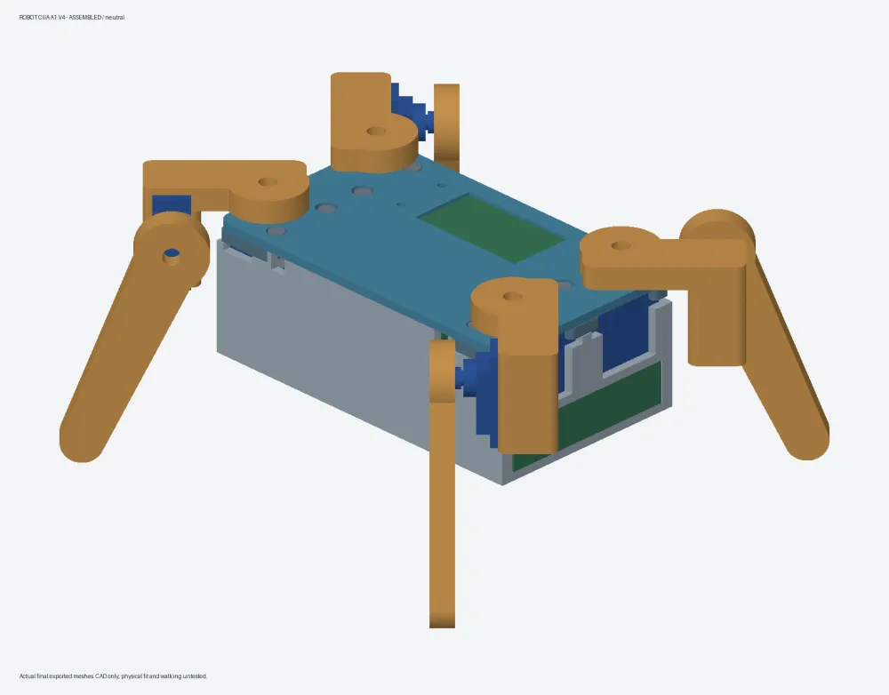

# Robot Cua A1 V4

English: [README.md](README.md) — có thêm phần Gallery đầy đủ ảnh.

Đồ chơi bốn chân, 8 SG90, quét QR để cài Wi-Fi và lái bằng web trên điện thoại. Dùng LILYGO T-Display-S3 non-touch + PCA9685 + thanh WS2812 8 bóng, cấp bằng pin dự phòng USB 5 V hai cổng. **BOARD GIẢ KiCad 30×20 mm không đặt, không lắp vào robot.**

Ngày 06/11/2026: team bridge **candidate_ready, teamReady=true**. Board, firmware, cơ khí và tích hợp đã được tester độc lập duyệt sau sửa. Chưa in, chưa nạp, chưa ráp, chưa chạy motor; chưa chứng minh robot đi được trên sàn.

## Bắt đầu

1. Xem [BOM](BOM.md), [hình tổng thể](docs/images/assembled.webp), [hình bung](docs/images/exploded.webp), [từ trên](docs/images/top.webp), [từ trước](docs/images/front.webp).
2. **Chỉ in thử trước:** [TEST ONLY + MATING_TEST](case/print/TEST-ONLY-coupons.3mf). Coupon không lắp vào robot; hai part MATING_TEST đạt thì giữ làm P05/P09. Làm [checklist](CHECKLIST-RAP.md), báo cả hai bộ thử đạt trước khi chọn plate sản xuất.
3. [Overview ráp từng bước](case/overview.html): Đủ bộ → Bước 1…9, Trước/Sau; từng bước có thẻ vít/tán, có bước cắm dây. Chi tiết mặc định đóng.
4. [Đấu dây có hình](firmware/WIRING.md), rồi [tự nạp firmware](firmware/README.md#nạp-firmware--người-dùng-tự-làm). Rút cổng USB nguồn servo khi nạp.
5. Quét QR Wi-Fi, chọn mạng nhà 2,4 GHz và nhập mật khẩu; sau đó quét QR địa chỉ web. Nếu điện thoại không tự mở trang đầu, mở `http://192.168.4.1/`. Giữ nút thì đi, thả thì dừng; mất heartbeat 600 ms thì ngừng dáng đi và về đứng mượt. Trang Ráp đưa về giữa/chỉnh tâm/lưu. Giữ BOOT 8 giây để xóa Wi-Fi.

## Bộ hiện tại

| Mục | Kết quả |
|---|---|
| Thân, không tính chân | 126×75×47 mm, gồm đầu vít nắp |
| Part / M3 | 12 part; 4 M3×12 + 4 M3×20; 8 tán M3; vít SG90 theo túi |
| In sản xuất | 2 plate PETG, khoảng 4h27 + 2h30 = 6h57; 186,9 g |
| Robot gồm pin | Khoảng 430–440 g **ước tính**, phải cân khi ráp |
| Góc khớp | CAD ±30°, mẫu mỗi 5°, khe nhỏ nhất 3,3 mm; bốn chân cùng pha |
| Đối xứng trên STEP | 0 mm / 0°; chưa kiểm bản in |
| Firmware | ESP32-S3 build được; host tests Wi-Fi, web, QR, API, Ráp, BOOT, gait và PCA đạt |

[Print all](case/print/production.3mf) chứa đủ P01–P12: plate 1 đáy+nắp, plate 2 chân+thanh đè. Hai plate tên **MỚI∕SỬA — CẦN IN**; ký tự ∕ thay / vì Bambu làm mất tên chứa /. Chưa có part bản này được xác nhận đã in. Sau khi xác nhận MATING_TEST đạt, inventory và plate sẽ được cập nhật, vẫn giữ đủ mọi part trong Print all.

Đúng cấu hình đã cho: Bambu A1, nozzle 0,4, PETG Basic Flow Rate Calibrated, layer 0,20, 2 walls, 7% Grid, tree auto. Hướng in từng part và thao tác ráp ở [hướng dẫn cơ khí](case/README.md), [bản đồ vít](case/fastener_map.csv). CAD nguồn ở `case/`; STEP/STL từng part ở `case/out/`; source firmware ở `firmware/crab/`; binary ở `build/firmware/esp32/crab.ino.bin`.

## GIẢ ĐỊNH và phần cần kiểm bằng tay

Kích thước SG90/horn, vỏ LILYGO/chân Dupont, PCA và thanh KK10 lấy theo mẫu tham chiếu, chưa đo đồ của chủ. Pin tối đa 100×65×15 mm, 120 g, mỗi cổng ≥2,4 A. Data WS2812 3,3 V nối thẳng chưa được thử: rút ngắn dây DIN sát GND; vẫn nhấp nháy thì rút thanh đèn ra dùng robot trước, không nối sang 3V.

Theo ghi chú tester, cần kiểm horn/hốc servo bằng coupon; độ cong dây dưới LILYGO/PCA và cạnh trụ đèn; quét QR khi đóng nắp; dấu quay servo thật, chân bám sàn và pin có tự ngắt. Đi ngang hiện là kết quả mô hình tiếp tuyến đơn giản, chưa mô phỏng tiếp xúc sàn. Dáng đi mặc định chậm để giảm dòng giật. Mất Wi-Fi đã lưu sẽ về AP sau 15 giây; muốn thử lại mạng đó thì khởi động lại hoặc nhập lại. Rời trang Ráp phải bấm **Xong Ráp** để mở khóa đi. Các việc này có cách đạt/không đạt trong [CHECKLIST-RAP](CHECKLIST-RAP.md), không cần đo điện.

Ghi chú chữ tiêu đề schematic có thể hiển thị mã Unicode thay tiếng Việt; silk cảnh báo PCB đúng. Báo cáo tiết diện có một số kích thước từ tham số CAD; tester đã đo lại các điểm gá nắp, đường vào tán và rãnh dây trên STEP. Chưa thử độ bền bản in. Không có `lead-document-findings.json` trong run; các ghi chú tester đã được đọc và các blocker đã được sửa, duyệt lại.

Print team tự động đã đọc file in và đề xuất chờ hai bộ thử, nhưng ghi đề xuất gặp lỗi `Print request needs verified plate and parts` hai lần. Lỗi handoff này không đổi `teamReady=true`; không có xác nhận in nào và không gửi lệnh in. Handoff hiện tại là in thử trước theo checklist. Pane Case → Overview không mở được trong môi trường không có cửa sổ; builder đã kiểm overview bằng Chrome headless ở desktop và phone 390 px.

## Tái tạo từ source

Chạy `./build.sh` trong môi trường KiCad Harness đã có KiCad, CadQuery, Bambu Studio, Arduino CLI/core/thư viện dùng chung. Script báo công cụ thiếu, không tải/cài qua mạng, không tự nạp/in/đặt hàng. Thứ tự: xuất/kiểm board → STEP → CAD → slice/3MF → overview và ảnh → firmware/tests. Các bước cache theo nguồn không đổi; kiểm clone sạch trước push được ghi ở [BUILD-VALIDATION.md](BUILD-VALIDATION.md).

Git chứa source, input và tài liệu; output/cache được ignore. Sau clone, các link output chỉ có file sau khi chạy build. Đổi máy cần cài các công cụ nêu trong [firmware README](firmware/README.md) và sửa đường thư viện tuyệt đối trong `firmware/flash.json` trước khi tự nạp; build script dùng cache ở `$CIRCUIT_FIRMWARE_CACHE`. [Yêu cầu gốc](prompts/original.md), [ảnh tham khảo thu nhỏ](references/IMAGES.md), [inventory](case/PRINTED-INVENTORY.md).
