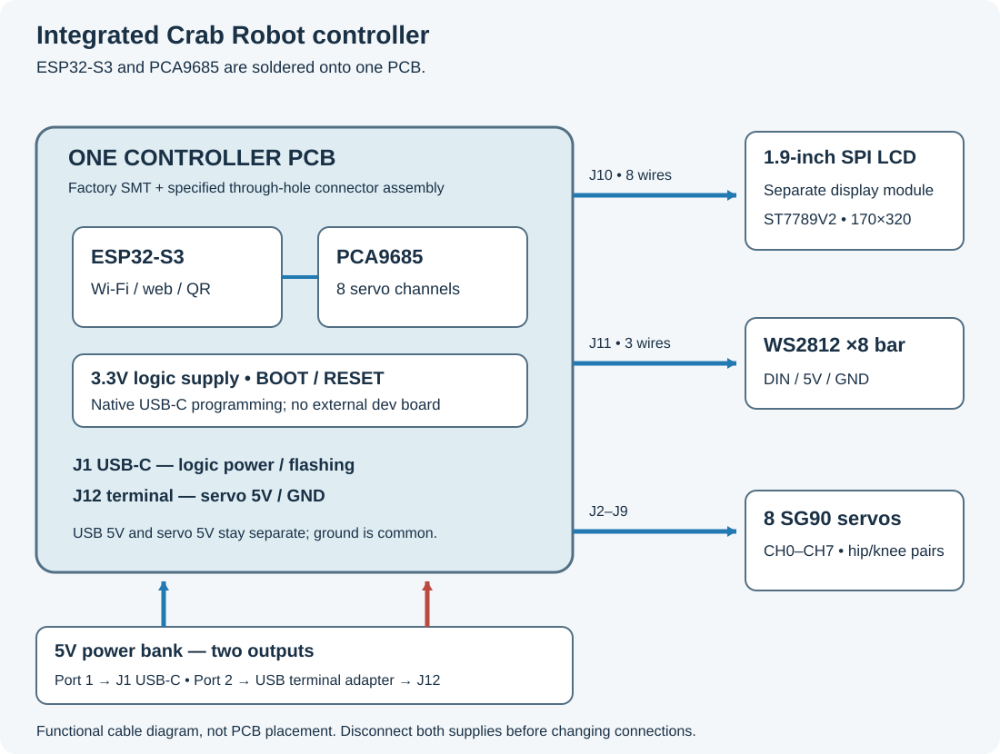

# Integrated controller: connect it by labels

The current prototype uses the side-entry USB-C PCB and two open frames. See [build validation](../BUILD-VALIDATION.md) for desktop checks and the remaining first-board tests.

This guide is for the custom ESP32-S3 + PCA9685 PCB. The original LILYGO + separate PCA module uses a different wiring guide and firmware target.

Unplug **both** power-bank outputs before changing connections. The USB-C input powers the controller and LCD. J12 powers the servos and light from the second 5 V output; it cannot be replaced by the controller's 3.3 V pin.

1. Run the port-1 cable to **J1 USB-C**, keeping its power-bank end unplugged while wiring. Use a data-capable cable when programming. Use a housing no larger than 12.5 × 7 × 25 mm and a cable no thicker than 4.5 mm. Route it through the rear bay/end window and outside the +Y rail to the side-facing port. The head projects about 20 mm beyond the body.
2. Connect the supplied Waveshare 23822 LCD harness to **J10**, matching the signal names in the table below. The screen is retained separately on the upper open frame.
3. Connect the LED bar's **input** end to **J11**: DIN to DIN, 5V to 5V, GND to GND. Follow the labels/arrows rather than the wire colors.
4. Wire the USB-to-terminal adapter to **J12 while the board is on the bench**: positive to +5V, negative to GND. Keep its port-2 USB end unplugged until first start. Keep the two positive supply inputs separate. The PCB already joins their grounds.
5. Plug the eight servos into **CH0–CH7** as below. Each servo plug has three wires: **brown → GND, red → +5V, orange → PWM**. Use the PCB labels to orient the plug.

## Which servo goes where?

Stand behind the robot, facing its front. Your left is the robot's left. Each leg has **two servos**: the hip turns the whole leg sideways; the knee raises/lowers the outer leg section. CH is the printed number of a servo socket, not a wire color or a GPIO number.

| Leg | Hip servo socket | Knee servo socket |
|---|---|---|
| Front left | CH0 / J2 | CH1 / J3 |
| Front right | CH2 / J4 | CH3 / J5 |
| Rear left | CH4 / J6 | CH5 / J7 |
| Rear right | CH6 / J8 | CH7 / J9 |

Thus “front left: CH0, CH1” means **two separate three-wire plugs**, one from each servo. Do not split a servo cable across the two sockets.

## LCD harness

| J10 pin | PCB label | LCD label | ESP32 GPIO |
|---:|---|---|---:|
| 1 | BL | BL | 38 |
| 2 | RES | RST / RES | 5 |
| 3 | DC | DC | 7 |
| 4 | CS | CS | 6 |
| 5 | SCK | SCL / CLK | 8 |
| 6 | MOSI | SDA / DIN | 39 |
| 7 | GND | GND | — |
| 8 | 3V3 | VCC | — |

Here SCL/SDA on the **LCD** mean SPI clock/data; the LCD is not attached to the PCA9685 I²C bus. PCA9685 wiring is already copper on the PCB: SDA GPIO18, SCL GPIO17, address 0x40, enable GPIO21. GPIO15 is unused on this board. J11 DIN is GPIO1.

## First start

Have the assembler complete its electrical inspection first. Leave the second supply and all servos disconnected while flashing the **integrated** target and checking the QR/Wi-Fi screen. Scan the setup QR, enter Wi-Fi details and open the robot's web control page. Hold BOOT for eight seconds while the application is running to return to Wi-Fi setup. For ROM programming, hold BOOT while pressing/releasing RESET instead.

For servo setup, turn power off, attach the servo plugs, then support the body with the legs free. Uncouple any already installed horn/leg assemblies from the output shafts. Use the assembly/center controls **before attaching the horns**; never centre an assembled leg against the frame. Fit the horns and legs using the case assembly guide, then test one joint at a time. Do not force a stalled servo. Walking, directions and calibration still require an actual first-prototype test.

If the LCD is blank or wiring is uncertain, remove power and have the assembler check the labels. Disconnect both power outputs to turn everything fully off; resetting the MCU is not a servo/LED power switch.
