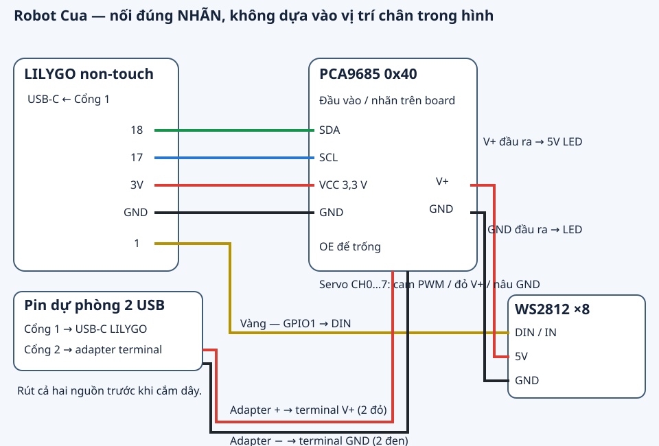
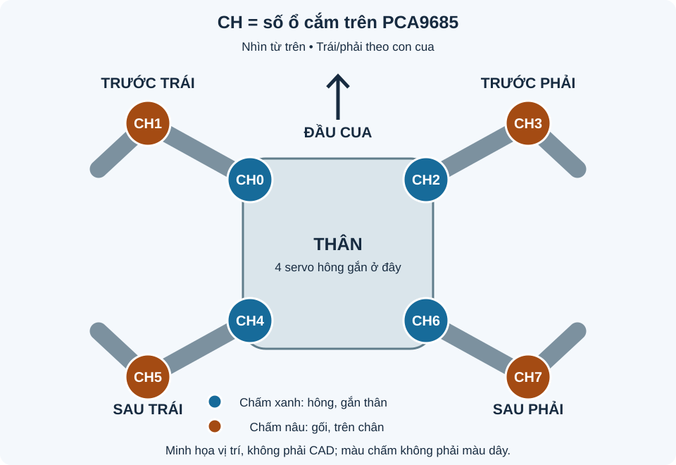

# Mua PCA9685 và cắm dây cho Robot Cua

Bản hướng dẫn cho **Robot Cua A1 V4, khung skeleton A1V4-r2**, LILYGO T-Display-S3 non-touch. Cập nhật ngày 2026-11-09 theo firmware đã nạp trên board của chủ.

**Chọn đúng phiên bản trước khi nối LED:** board đã nạp ngày 09/11 dùng **GPIO1**; source baseline 06/11 đang lưu trong repo dùng **GPIO21** trong [Config.h](../firmware/crab/Config.h). Bốn dây PCA và CH0–CH7 giống nhau. Hướng dẫn/hình dưới đây dành cho board đã nạp ngày 09/11; nếu tự build baseline trong repo, dùng GPIO21 cho DIN. Khung skeleton r2 đã kiểm ở workspace, chưa được nhập vào bộ source baseline này. Đừng nạp đè baseline để làm theo hướng dẫn board hiện tại.

## Cần mua đúng món nào?

**Mua 1 module PCA9685 điều khiển 16 servo qua I²C, bản đã hàn sẵn chân.** Đây là bo riêng, không có sẵn trên LILYGO. Một bo đủ cắm 8 servo của cua; hai servo dự phòng để rời.

Từ khóa để tìm lại: **`PCA9685 16 kênh điều khiển servo I2C hàn sẵn chân`**.

Nhận ra đúng loại qua các điểm sau:

- 16 cụm chân servo, mỗi cụm **3 chân**, đánh số **0–15**.
- Terminal vặn vít cấp nguồn, có nhãn `V+` và `GND` hoặc `+`/`−`.
- Hàng chân tín hiệu có chữ `VCC`, `GND`, `SDA`, `SCL` (thường thêm `OE`, `V+`).
- Chọn bản đã hàn đủ các hàng chân và terminal để chỉ cần cắm dây/vặn vít.

Ảnh shop bạn gửi có tiêu đề “Mạch driver PCA9685 (Driver điều khiển 16 servo), giao tiếp I2C”: **đúng loại module cần mua**. Ảnh minh họa không xác nhận kích thước, chất lượng hoặc tình trạng giao hàng của bo thực nhận. Giá/tồn kho không được dùng làm thông số trong hướng dẫn này.

## Chỗ dễ nhầm trong ảnh shop

Ảnh shop nối với **Arduino Uno**, ghi `VCC → 5V`, `SDA → A4`, `SCL → A5`. Với **LILYGO của con cua**, dùng bảng sau:

| Từ LILYGO | Đến PCA9685 | Màu dây gợi ý |
|---|---|---|
| `3V` / `3V3` | `VCC` | đỏ mảnh |
| `G` / `GND` | `GND` | đen |
| `18` | `SDA` | xanh lá |
| `17` | `SCL` | xanh dương |

**`VCC` là nguồn logic 3,3 V. `V+` là nguồn servo 5 V riêng. Không nối hai chân này với nhau.** Đọc nhãn in trên bo; màu dây chỉ giúp nhận ra dây. Phân biệt hai nguồn theo [pinout chính thức của Adafruit](https://learn.adafruit.com/16-channel-pwm-servo-driver/pinouts); VCC cũng cấp cho điện trở kéo lên SDA/SCL.

## CH0…CH7 nghĩa là gì?

**CH là số chỗ cắm trên PCA9685. Mỗi chân cua có hai servo:**

- **Hông:** servo gắn vào thân, xoay cả chân qua lại.
- **Gối:** servo nằm trên chân, nâng/hạ phần chân dưới.

Ví dụ chân trước trái: giắc servo gắn thân cắm vào số **0**; giắc servo nằm trên chân cắm vào số **1**.

Đầu cua là phía rút pin ra. Trái/phải tính theo con cua:

| Chân cua | Servo gắn thân (hông) | Servo nằm trên chân (gối) |
|---|---:|---:|
| Trước trái | CH0 | CH1 |
| Trước phải | CH2 | CH3 |
| Sau trái | CH4 | CH5 |
| Sau phải | CH6 | CH7 |

Nếu 8 servo đang để rời, chúng cùng loại: chọn từng con rồi dán nhãn vị trí trước khi lắp. Mỗi con cắm **nguyên giắc 3 dây vào cùng một kênh**: **nâu → `GND/−`, đỏ → `V+/+`, cam → `PWM/S`**. Giữ CH8–15 trống.

## Nguồn và đèn

**Rút USB và cả hai cổng pin dự phòng trước khi cắm/sửa dây.**

1. Cổng 1 pin dự phòng → cáp USB-C → LILYGO.
2. Cổng 2 → đầu chuyển USB–terminal: `+` → terminal `V+` PCA9685, `−` → terminal `GND` PCA9685. Nếu dùng dây Dupont đực–đực cho nguồn như bộ dây hiện tại, mỗi cực dùng hai dây song song, cùng siết chắc trong terminal; không để lõi đồng lòi ra ngoài.
3. LED: LILYGO `1` → `DIN/IN`; PCA9685 `V+` → LED `5V`; PCA9685 `GND` → LED `GND`.
4. Để trống `OE`, giữ cầu địa chỉ A0–A5 nguyên trạng (GIẢ ĐỊNH module mặc định 0x40).

Chừa vòng dây dư qua khớp. Với skeleton r2, dây từ LILYGO sang PCA luồn khe sống giữa; dây hông trước-trái luồn đường hầm dưới gối LILYGO trước khi đặt board. Dùng hai dây rút giữ thanh LED giữa các bóng, tránh đội dải tán sáng.

## Lần đầu bật sau khi cắm

Firmware đã được nạp và verify trên LILYGO; bạn xác nhận QR và trang quét Wi-Fi hoạt động. **Chưa có PCA9685 thì dòng “Kiểm tra dây PCA9685” là bình thường.**

Sau khi nhận module và nối đúng bốn dây logic, tắt/bật lại LILYGO để nó nhận PCA; lỗi I²C được giữ khóa tới lần khởi động mới. Cổng servo vẫn để ngắt trong lúc kiểm QR/Wi-Fi. Khi ráp cơ khí xong, kê chân khỏi bàn rồi mới cấp nguồn servo và vào **Ráp → Giữa thô 1500 µs** trước khi gắn horn. Chưa có xác nhận servo/LED/robot đi thật.

Xem thêm: [đấu dây đầy đủ](../firmware/WIRING.md) · [BOM](../BOM.md) · [checklist ráp](../CHECKLIST-RAP.md) · [trạng thái đã thử](STATUS.md).
