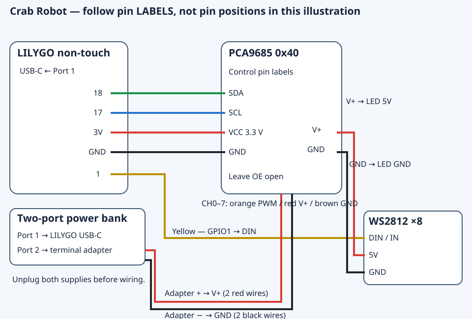
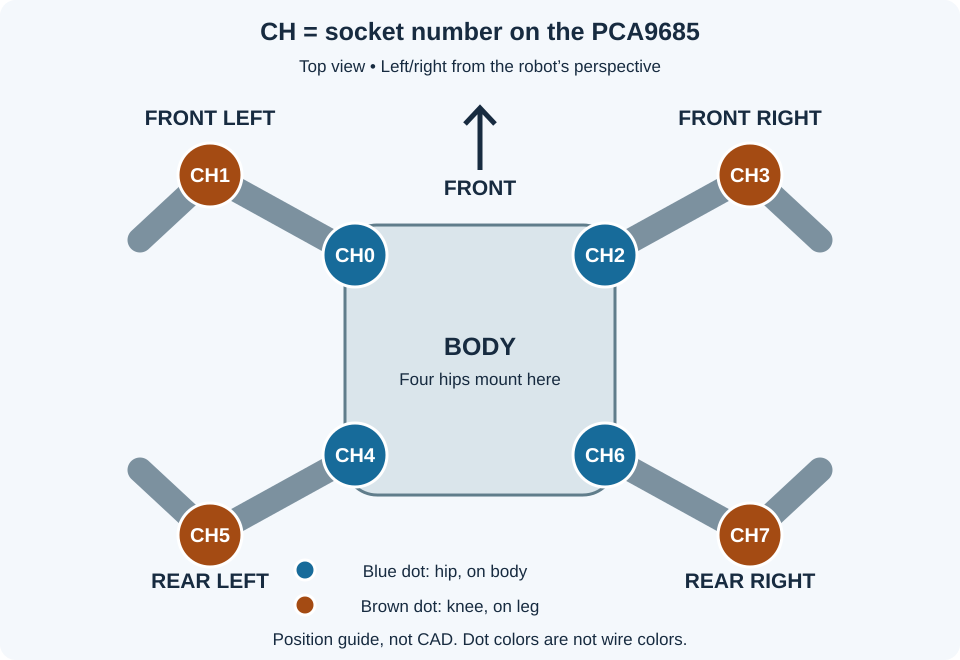

# Buying and wiring a PCA9685 for the Crab Robot

For **Crab Robot A1 V4 / skeleton A1V4-r2**, using the LILYGO T-Display-S3 non-touch. Updated 9 November 2026 for the firmware already flashed on the owner's board. [Tiếng Việt](PCA9685-VA-DAU-DAY.md).

**Choose the correct version before connecting the LED:** the board flashed on 9 November uses **GPIO1**. The 6 November source baseline in this repository uses **GPIO21**, as defined in [Config.h](../firmware/crab/Config.h). The four PCA connections and CH0–CH7 assignments are identical. The diagram below is for the flashed board; use GPIO21 for DIN if you build the repository baseline. Skeleton r2 has been checked in the workspace but is not part of this baseline source tree. Do not overwrite the working board with the baseline just to follow this guide.

## What to buy

Buy **one PCA9685 16-channel I²C servo driver module with soldered headers**. It is a separate board, not built into the LILYGO. One module handles all eight robot servos; keep the two spare servos aside.

Search: **`PCA9685 16 channel servo driver I2C pre soldered`**. For Vietnamese shops: `PCA9685 16 kênh điều khiển servo I2C hàn sẵn chân`.

Look for:

- Sixteen servo sockets, each with **three pins**, numbered **0–15**.
- A power screw terminal marked `V+` and `GND`, or `+` and `−`.
- Control pins labeled `VCC`, `GND`, `SDA` and `SCL`, often with `OE` and `V+` too.
- All headers and the terminal already soldered, so assembly only needs plugging in and tightening screws.

The owner's shop screenshot shows the correct module type. The picture does not confirm the delivered board's dimensions, quality or shipping status. Price and stock are not design specifications.

## Do not copy the shop's Arduino Uno wiring

The shop diagram shows `VCC → 5V`, `SDA → A4` and `SCL → A5` on an **Arduino Uno**. For this **LILYGO**, use:

| From LILYGO | To PCA9685 | Suggested wire color |
|---|---|---|
| `3V` / `3V3` | `VCC` | Thin red |
| `G` / `GND` | `GND` | Black |
| `18` | `SDA` | Green |
| `17` | `SCL` | Blue |

**`VCC` is the 3.3 V logic supply. `V+` is the separate 5 V servo supply. Do not join them.** Follow the printed pin labels; wire colors are only a visual aid. The [official Adafruit pinout](https://learn.adafruit.com/16-channel-pwm-servo-driver/pinouts) explains these supplies; VCC also powers the SDA/SCL pull-up resistors.

## What do CH0–CH7 mean?

**CH is a numbered socket on the PCA9685. Each robot leg has two servos:**

- **Hip:** mounted on the body; swings the entire leg.
- **Knee:** mounted on the leg; raises or lowers the lower section.

For example, the front-left leg's body-mounted servo plugs into **0**; its leg-mounted servo plugs into **1**.

The robot's front is the battery removal end. Left and right are from the robot's perspective:

| Robot leg | Body-mounted hip servo | Leg-mounted knee servo |
|---|---:|---:|
| Front left | CH0 | CH1 |
| Front right | CH2 | CH3 |
| Rear left | CH4 | CH5 |
| Rear right | CH6 | CH7 |

If all eight servos are loose, they are the same type: assign and label their positions before installation. Plug each **complete three-wire connector into one channel**: **brown → `GND/−`, red → `V+/+`, orange → `PWM/S`**. Leave CH8–CH15 empty.

## Power and LEDs

**Unplug USB and both power-bank outputs before connecting or changing wires.**

1. Power-bank port 1 → USB-C cable → LILYGO.
2. Port 2 → USB-to-screw-terminal adapter: `+` → PCA9685 `V+` terminal; `−` → PCA9685 `GND` terminal. If using the current male-to-male Dupont power leads, use two parallel wires per polarity, secured together in the terminal, with no exposed copper outside it.
3. LED bar: LILYGO `1` → `DIN/IN`; PCA9685 `V+` → LED `5V`; PCA9685 `GND` → LED `GND`. **Use GPIO21 instead of 1 for repository baseline firmware.**
4. Leave `OE` unconnected and address jumpers A0–A5 unchanged. **ASSUMPTION:** the module uses its default I²C address, 0x40.

Leave slack loops across joints. On skeleton r2, route LILYGO-to-PCA wires through the center-spine opening; pass the front-left hip wire through the tunnel under the LILYGO support before seating the board. Secure the LED bar with two cable ties between LEDs without lifting the diffuser strip.

**ASSUMPTION:** the LED accepts direct 3.3 V data. Keep DIN short and next to GND. If it flickers, disconnect power, shorten/reroute DIN and retry; if flicker persists, leave the LED disconnected and use the robot without it. Do not power the LED bar from the LILYGO's 3V pin.

## First power-up after wiring

Firmware has been flashed and verified on the LILYGO; the owner confirmed QR display and the Wi-Fi scan page. **Without a PCA9685, the Vietnamese message “Kiểm tra dây PCA9685” (“Check PCA9685 wiring”) is expected.**

After receiving the module and connecting the four logic wires, power-cycle the LILYGO so it detects the PCA. An I²C fault stays latched until restart. Keep servo power disconnected while checking QR/Wi-Fi. Once the mechanics are assembled, support the body with the feet clear, then enable servo power and open **Ráp → Giữa thô 1500 µs** (“Assembly → Raw center 1500 µs”) before fitting horns. Servos, LEDs and real walking remain unconfirmed.

More: [baseline full wiring, in Vietnamese](../firmware/WIRING.md) · [BOM](../BOM.md) · [assembly checklist, in Vietnamese](../CHECKLIST-RAP.md) · [tested status and versions](STATUS.md).
