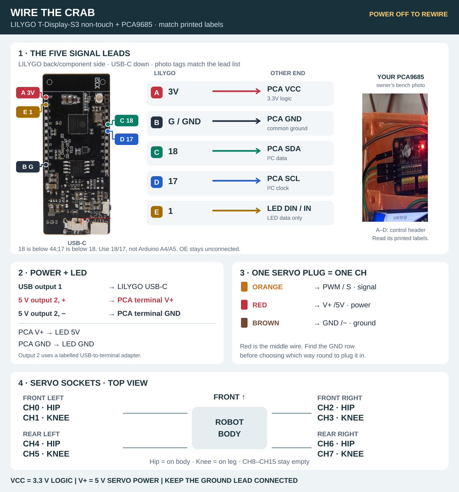

# Wire the existing crab

**LILYGO T-Display-S3 non-touch + separate PCA9685.** This is the hardware on the owner's bench. Use the built-in screen and USB-C to identify the LILYGO, and the sixteen three-pin servo sockets to identify the PCA.

[Back to README](../README.md#wire-it) · [All wiring on one sheet](../docs/images/wiring-quick-reference.svg) · [Servo map](#eight-servos-mean-eight-three-wire-plugs) · [Troubleshooting](#if-something-does-not-work)

## Original LILYGO and bought PCA9685

Unplug LILYGO USB **and** the separate servo supply before changing wires. Wire colours below are suggestions; printed labels at both ends decide the connection.

[](../docs/images/wiring-quick-reference.svg)

### 1. Find the pins on the real board

The photo on the sheet shows the **back/component side of the LILYGO, USB-C down**. It uses the same owner-supplied reference as [the full original pinout](../references/user-images/2026-11-10-owner-supplied-lilygo-pinout.png), with only the needed pins called out.

| Photo tag | Pin to find | Plug its other end into | Suggested wire |
|---|---|---|---|
| **A** | Upper-left **`3V`** | PCA **`VCC`** | Thin red |
| **B** | Left **`G` / `GND`**, just above `5V` | PCA **`GND`** | Black |
| **C** | Right **`18`**, just below `44` | PCA **`SDA`** | Green |
| **D** | Right **`17`**, just below `18` | PCA **`SCL`** | Blue |
| **E** | Left **`1`**, just below upper `3V` | LED input **`DIN` / `IN`** | Yellow |

The PCA's six-pin control header has labels **`GND`, `OE`, `SCL`, `SDA`, `VCC`, `V+`** on the Adafruit-style reference breakout. Equivalent headers can appear at both short ends; use a labelled header you can reach. Header orientation varies between clones, so use the printed names. The board photograph on the sheet is the owner's received breakout; the adjacent connection list identifies functions, not an invented hole-by-hole clone pinout.

Use female-to-female Dupont leads. **`U1RXD` / `U1TXD` beside LILYGO 18/17 are alternate functions:** this application assigns 18 to SDA and 17 to SCL. Do not copy Arduino Uno `A4`/`A5` wiring from a seller's illustration. Leave `OE` unconnected on this reference breakout. No other LILYGO GPIO is needed for this module setup.

**First check:** connect A–D only, with servo plugs and servo power still disconnected. Power LILYGO by USB. Open the web controller and check that it does not report **Kiểm tra dây PCA9685**. After correcting a PCA connection while unpowered, restart LILYGO: an I²C fault remains latched until reboot.

### 2. Connect power: one 5 V supply into the PCA (owner, 2026-11-17)

The owner now runs the whole crab from **one 5 V supply into the PCA screw terminal**. A short red lead from that terminal feeds the LILYGO, so there is no USB cable trailing behind the crab.

| Wire | From | To |
|---|---|---|
| Supply + | 5 V supply (power-bank output, or the LM2596 in [battery power](BATTERY-AUTONOMY.md#battery-now-with-parts-already-owned)) | PCA screw terminal **`V+` / `+`** |
| Supply − | The same supply | PCA screw terminal **`GND` / `−`** |
| **F** (new, red) | PCA screw terminal **`V+`** | LILYGO **`5V`**: bottom of the left column, beside USB-C, just below `GND` |
| Common ground B | LILYGO **`G` / `GND`** | PCA **`GND`**. Keep this lead connected |
| 1000 µF capacitor | Long leg to the **`V+`** terminal, striped leg to **`GND`** | Across the terminal, legs short, in the same clamps as the supply |
| Optional second 1000 µF | Long leg to LILYGO **`5V`**, striped leg to the `GND` just above it | Add it if the crab still shows **Sụt áp** |

```text
5 V supply + ──► PCA V+ ──┬── 1000 µF (+ long leg) ──┐
                          ├── servos, LED 5V          │
                          └── lead F ──► LILYGO 5V    │
5 V supply − ──► PCA GND ─┴───────────────────────────┴── lead B ──► LILYGO G
```

The capacitor is not in the line. It sits **across** `V+` and `GND`: one leg on each, next to the supply wires. When a servo kicks, the capacitor tops up the rail so the board does not reset.

**Rules:**
- **Unplug the LILYGO's USB-C** while lead F is fitted. Two 5 V sources would fight.
- **To flash over USB:** switch off or unplug the PCA supply **first**, then plug in the computer. The LILYGO `5V` pin and USB VBUS are joined through a fuse only, so the supply would feed the computer's port. OTA over Wi-Fi needs no change.
- **PCA `VCC` (3.3 V logic, lead A) and PCA `V+` (5 V) are different.** Never bridge them. Lead F goes to `V+`, never to `VCC`.
- **LILYGO `5V`, not `3V`.** The other `3V` pin sits at the bottom of the right column, level with `5V`. 5 V on a `3V` pin destroys the board.
- **The supply must give 5.0–5.5 V**, and now carries the servos and the board together. Use the strongest power-bank port (2.1–3 A).
- If the screen shows **Sụt áp**:
  - fit the second capacitor;
  - lower **Tốc độ** to about 60–70 % and the knee lift a little;
  - then tap **Bật servo**.
- Read the terminal `+`/`−` marks; the apparent left/right positions change when you rotate the board. Clamp bare metal, not insulation, and leave no loose strand between terminals. Twist each capacitor leg with its supply wire before clamping.
- A Schottky diode (1N5819) in lead F, stripe towards the LILYGO, with the second capacitor on the LILYGO side, holds the board up through deeper dips. It is optional. Do not use a 1N4007: it drops about 0.8 V.

**Before 2026-11-17** the crab used two power-bank outputs: one into the LILYGO's USB-C, one into the PCA terminal, with lead B as the common ground. That still works; leave lead F off if you go back to it.

### 3. Connect the light

| LED label | Connect to |
|---|---|
| **`DIN` / `IN`** at the arrow's input end | LILYGO **`1`**, lead E |
| **`5V` / `VCC`** | PCA servo-side **`V+`** |
| **`GND` / `−`** | PCA **`GND`** |

LED data is separate from the servo channels. Do not connect DIN to a PCA PWM socket. Do not power the stick from LILYGO 3V/5V. Direct 3.3 V LED data is an **ASSUMPTION** for the owned stick; if it flickers, shorten data beside GND, keep configured brightness low and leave it disconnected if unresolved. The firmware caps brightness at 16/255.

### 4. Connect the two ultrasonic sensors (Tự đi)

Use two **HC-SR04P** modules, the 3.3 V version. Each has four pins, printed **`VCC` · `Trig` · `Echo` · `GND`**.

| Sensor pin | **Left** eye | **Right** eye |
|---|---|---|
| `Trig` | LILYGO **`10`** | LILYGO **`12`** |
| `Echo` | LILYGO **`11`** | LILYGO **`13`** |
| `VCC` | LILYGO **`3V`**, bottom of the right column | The same pin: twist or solder both `VCC` leads together |
| `GND` | A right-column **`G`** | The other right-column **`G`**, or a `GND` at its top |

```text
   LEFT COLUMN            RIGHT COLUMN
   3V   lead A            GND
   1    lead E (LED)      GND
   2                      43
   3                      44
   10 ◄ left Trig         18  lead C (SDA)
   11 ◄ left Echo         17  lead D (SCL)
   12 ◄ right Trig        21
   13 ◄ right Echo        16
   NC                     NC
   NC                     G  ◄ left GND
   GND  lead B            G  ◄ right GND
   5V   lead F            3V ◄ both VCC
        (USB-C end)
```

- **`VCC` on `3V`, never `5V`.** A sensor powered from 5 V answers with a 5 V `Echo`, which the ESP32-S3 pin cannot take. A 5 V HC-SR04 (not "P") needs a 1k / 2k divider on `Echo`.
- **Left** means the robot's left: stand behind the crab looking towards Tiến (the screen side). The left module on the [front sonar head](../case/sonar_front/README.md) looks to your left.
- A swapped `Trig` / `Echo` damages nothing, but that side reads nothing.
- **Check:** open `/radar` (http://192.168.4.1/radar on the crab's own Wi-Fi).
  - Both **Trái** and **Phải** should show cm, not "—".
  - Cover the left eye with a hand: the **Trái** number should drop and the left arc should turn red.
  - If **Phải** reacts instead, swap the pairs 10/11 ↔ 12/13.

## Eight servos mean eight three-wire plugs

**Hip = on the body. Knee = on the leg.** Mark FRONT on the body. The following is a top view, with FRONT pointing away from you.

```text
                         FRONT ↑
      FRONT LEFT                       FRONT RIGHT
      Hip  → CH0                       Hip  → CH2
      Knee → CH1                       Knee → CH3
                ┌──────────────────┐
                │    ROBOT BODY    │
                └──────────────────┘
      REAR LEFT                        REAR RIGHT
      Hip  → CH4                       Hip  → CH6
      Knee → CH5                       Knee → CH7
```

> **Owner build, 2026-11-13:** on the real robot CH0 sits at the **rear right**. The robot's front is the CH4/CH6 end: CH0/1 rear right, CH2/3 rear left, CH4/5 front right, CH6/7 front left. Firmware `positional180-v11` and later use this layout; see the README. The diagram above is the original plan.

| Leg | Body-mounted hip plug | Leg-mounted knee plug |
|---|---|---|
| Front left | **CH0** | **CH1** |
| Front right | **CH2** | **CH3** |
| Rear left | **CH4** | **CH5** |
| Rear right | **CH6** | **CH7** |

| Wire in each complete servo plug | PCA row label |
|---|---|
| **Orange** | **`PWM` / `S`** — signal |
| **Red**, middle wire | **`V+` / `5V`** — servo power |
| **Brown** | **`GND` / `−`** — ground |

Do not split one servo's three wires across channels. Leave CH8–CH15 empty and spare servos loose. Find the labelled GND row before seating a plug; red being in the middle does not distinguish the two possible outer-wire orientations.

Label all eight leads before routing. Leave a free loop across each joint, avoid tight bends at the servo exit and keep wires away from moving horns. Protect insulation at the owner's hand-cut openings. New-frame CAD routing does not prove cable clearance in the owner's modified printed body.

## Check positional versus continuous rotation

The photographed SG90s are the owner's **continuous 360° motors**. The loaded timed experiments caused collisions/erratic motion and are paused; see [the actual experiment outcome](EXPERIMENT-STATUS.md). Changing wiring cannot add position feedback.

Replacement parts for this jointed-leg mechanism must be **positional** servos. “SG90” alone is insufficient; the seller variant must actually move to and hold requested angles. The owner now reports the180° replacements delivered at home; the company-bench update has no replacement motor present for a physical test. Test one unloaded replacement's response and fit before attaching a leg. Keep every old continuous-rotation unit unplugged from this180° release.

## First power and centring

1. Leave servo 5V and all servo plugs disconnected. Power LILYGO only; confirm QR/web access and PCA detection.
2. Prepare one new motor at a time with its horn/leg uncoupled from the shaft. Follow the [180° first-connection procedure](POSITIONAL180.md): **Ráp → Bật servo180° → Giữa thô**, then wait about3seconds. Disconnect servo power before moving plugs or fitting horns.
3. Disconnect power before attaching horns in the neutral pose. Support the body, check free hand movement and cable slack, then use small positional trims, **Lưu tâm** and **Xong ráp** as described in the firmware guide.

Do not force gears or use powered movement to overcome binding. Disconnect servo power before reset/flashing; BOOT/reset is not a servo power switch. Disconnect both supplies to turn everything off.

## If something does not work

| What you see | First thing to check, with power removed before rewiring |
|---|---|
| Screen works; PCA error | A–D, especially18 → SDA,17 → SCL and3V → VCC; then restart |
| PCA LED is on; no servo movement | Separate servo 5V at terminal V+, plug orientation and selected motor mode; a lit logic LED does not prove servo power |
| Servo spins continuously | Actual motor is probably continuous-rotation; stop and identify its variant rather than trying to centre it |
| LED does not light | Lead E at GPIO 1, LED DIN input direction, separate 5 V and common GND |
| Reset, bank shutdown or hot/binding motor | Disconnect servo power, check binding and supply/cable suitability |

## Integrated board

The future PCB contains the controller and PCA already. Its J1–J12 connector map is a different setup: follow the [integrated wiring guide](../docs/INTEGRATED-WIRING.md). Do not mix its connector numbers or display pins with the LILYGO module guide above.

References: [LILYGO manufacturer repository](https://github.com/Xinyuan-LilyGO/T-Display-S3), [Adafruit PCA9685 pin definitions](https://learn.adafruit.com/16-channel-pwm-servo-driver/pinouts), [the project's actual GPIO definitions](crab/hardware.h).
