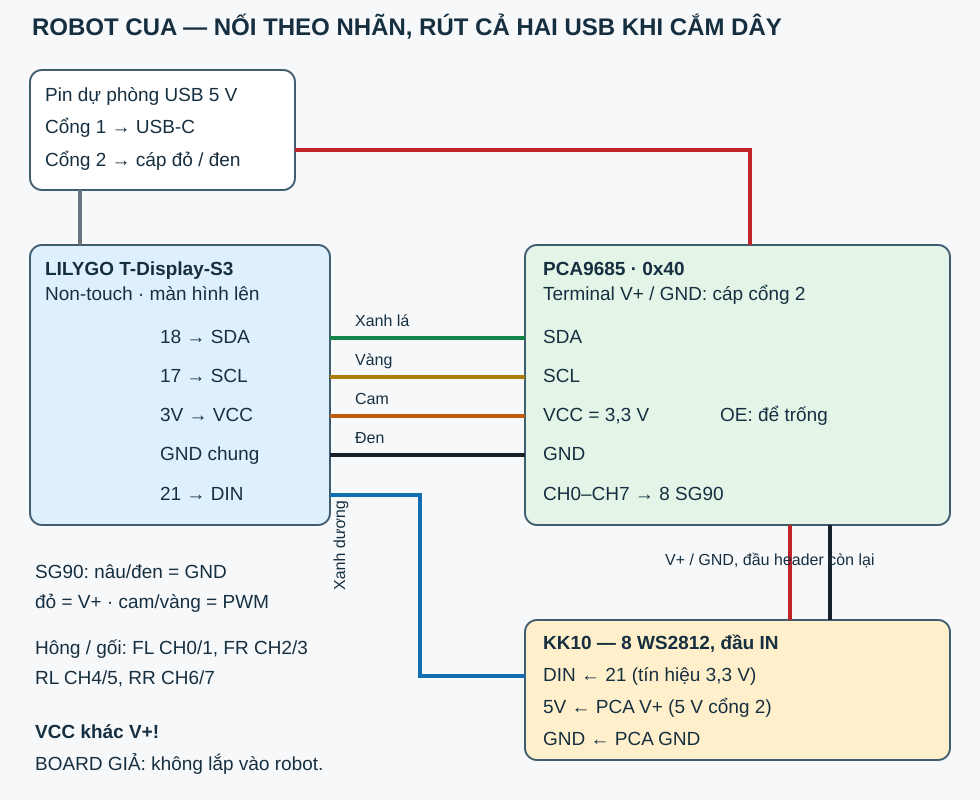

# Đấu dây Robot Cua — nhìn nhãn rồi cắm

> **Phiên bản baseline 06/11:** source này dùng LED GPIO21. Board của chủ đã nạp firmware mới ngày 09/11 dùng GPIO1; xem [hướng dẫn hiện tại](../docs/PCA9685-VA-DAU-DAY.md) và [trạng thái](../docs/STATUS.md). Bốn dây PCA và CH0–CH7 không đổi.

**Bản dùng dây trực tiếp:** LILYGO T-Display-S3 **non-touch**, PCA9685 địa chỉ **0x40**, 8 SG90, thanh KK10 8 WS2812. **BOARD GIẢ KiCad không đặt, không lắp vào robot.** Sơ đồ KiCad không phải sơ đồ dây robot; dùng tài liệu này và `crab/Config.h`.

## Trước khi cắm

Rút **cả hai đầu USB-A khỏi pin dự phòng**. Nhìn mặt có chữ trên module. Đọc đúng **nhãn in bên cạnh từng chân**, không đếm từ đầu giắc và không suy từ vị trí trong hình: ảnh/sơ đồ không phải thước đo hay pinout của mọi clone. LILYGO đặt màn hình hướng lên, USB-C ở đầu sau của thân; PCA đặt mặt có chữ/kênh lên trên. Hàng servo có ba đường **PWM / V+ / GND**. Không cắm khi chưa nhận ra đúng nhãn.

**GIẢ ĐỊNH:** board LILYGO đúng schematic ngày 29/04/2024, có sẵn chân cắm, nhãn `18`, `17`, `21`, `3V` (hoặc `3V3`) và `GND`. PCA đúng kiểu Adafruit, có VCC, V+, GND, SDA, SCL, OE; A0–A5 không nối cầu hàn (0x40). Không đổi sang board touch. Nếu chữ trên board khác, dừng phần dây đó và đối chiếu đúng mẫu trước; firmware không tự đổi chân.

## 1 — Nguồn, chỉ dùng pin dự phòng 5 V mua sẵn

| Từ đâu — nhãn | Đến đâu — nhãn | Dây / cách làm |
|---|---|---|
| Pin dự phòng, cổng USB-A **1** | USB-C LILYGO | Cáp USB-A → USB-C **có truyền dữ liệu**, ngắn, đầu gập nếu cần |
| Pin dự phòng, cổng USB-A **2** | Terminal PCA **V+ / +** | Cáp USB-A ra hai dây: **đỏ +5 V** vào V+, siết vít terminal |
| Cùng cáp cổng 2 | Terminal PCA **GND / −** | **Đen GND** vào GND, siết vít terminal |

Hai nguồn 5 V đến từ hai cổng riêng, không nối V+ servo vào chân 5V của LILYGO. Không dùng pin rời, không có mạch nguồn tự ráp. Không cắm thêm pin lithium vào LILYGO. Dây trần chỉ nằm trong terminal, không ló sợi đồng ra ngoài; kéo nhẹ từng dây để kiểm đã giữ chắc.

## 2 — Bốn dây tín hiệu giữa hai module

| Nhãn LILYGO → nhãn PCA9685 | Màu gợi ý | Ý nghĩa |
|---|---|---|
| **18 (GPIO18) → SDA** | Xanh lá | Dữ liệu I²C 3,3 V |
| **17 (GPIO17) → SCL** | Vàng | Nhịp I²C 3,3 V |
| **3V / 3V3 → VCC** | Cam | Nguồn logic 3,3 V; **VCC khác V+** |
| **GND → GND** | Đen | Dây mass chung, phải có dù hai USB cùng pin dự phòng |

Dùng Dupont cái–cái. Chân **OE để trống**, theo module Adafruit có sẵn kéo xuống. Không nối VCC PCA vào 5 V; các điện trở kéo lên I²C trên module phải về VCC = 3,3 V. Không thêm điện trở/tụ rời. GPIO16 có RINT kéo lên và GPIO43 phát UART lúc ROM khởi động: **không dùng hai chân này**. Chân 0 là nút BOOT sẵn trên board; không phải dây nối ra servo.

## 3 — Tám giắc SG90 nguyên bộ

Nhìn từ trên robot, **đầu cua hướng ra xa bạn**: trái là trái của cua. Hông nằm trên thân, gối nằm trên chân. Mỗi giắc 3 dây cắm vào một kênh: **nâu/đen → GND**, **đỏ → V+**, **cam/vàng → PWM**. Đối chiếu chữ trên PCA; không dựa riêng vào màu nhựa hay phía mép board.

| Kênh PCA | Servo | Nhãn dây nên dán |
|---|---|---|
| **CH0** | Trước trái, hông | FL-H |
| **CH1** | Trước trái, gối | FL-K |
| **CH2** | Trước phải, hông | FR-H |
| **CH3** | Trước phải, gối | FR-K |
| **CH4** | Sau trái, hông | RL-H |
| **CH5** | Sau trái, gối | RL-K |
| **CH6** | Sau phải, hông | RR-H |
| **CH7** | Sau phải, gối | RR-K |

CH8–CH15 để trống; hai SG90 dự phòng để rời. **Vòng dây dư** qua mỗi khớp, giữ dây về phía thân, tránh horn và mép nắp; khi chưa cấp điện, xoay nhẹ trong khoảng cho phép và thấy dây không căng/kẹp. Không ép ngược hộp số servo. Dùng dây rút/đai giữ bó dây, để đầu cáp USB tháo được.

## 4 — Thanh đèn: nối đầu IN

| Từ đâu → đến đâu | Màu gợi ý |
|---|---|
| LILYGO **21 (GPIO21) → DIN / IN** của thanh | Xanh dương |
| PCA **V+** ở đầu header còn lại → **5V / VCC** thanh | Đỏ |
| PCA **GND** ở đầu header còn lại → **GND** thanh | Đen |

Mũi tên trên thanh đi **từ DIN vào các LED**. Không cắm vào DOUT/OUT. **GIẢ ĐỊNH:** thanh đã có ba dây; nếu chỉ có pad thì cần **3 mối hàn ngắn** ở đầu IN, đây là phần duy nhất có thể phải hàn. Có thể nhờ cửa hàng gắn sẵn dây để chỉ phải cắm. Đừng xoắn dây trần lên pad.

Dữ liệu 3,3 V nối trực tiếp là **GIẢ ĐỊNH**, chưa thử với thanh KK10 của bạn. Firmware giới hạn sáng 20%, cả 8 bóng cùng màu, tắt khi chương trình khởi động. Nếu nhấp nháy: rút nguồn, rút ngắn dây DIN và đi DIN sát GND, rồi thử lại. Không đổi dây 5 V của thanh sang 3V: điện áp tối thiểu của WS2812B tham chiếu là 3,5 V, nên cách đó không được bảo đảm. Nếu vẫn nhấp nháy, để thanh đèn rút ra và dùng cua trước; ghi kết quả để chọn thanh thay thế tương thích dữ liệu 3,3 V. Không thêm mạch vào bản này. Xem [DEVIATIONS.md](DEVIATIONS.md).

## 5 — Ráp và bật lần đầu, không cần đo điện

1. Rút cả hai USB; so từng nhãn theo bảng. Không có dây đỏ vào GND, không có V+ vào VCC, không lắp board giả.
2. Nạp firmware khi **USB cổng 2 chưa cắm**, servo không có nguồn. Xem [README.md](README.md).
3. **Chưa gắn horn** trong lần thử servo đầu. Kê thân cho các trục/chân không chạm bàn. Cắm cổng 1 rồi cổng 2. Servo nhận xung đứng giữa lần lượt: CH0, CH2, CH4, CH6, CH1, CH3, CH5, CH7, cách nhau 0,3 giây. Trục có thể xoay khi bắt đầu nhận xung.
4. Đèn tắt. Màn hình có QR và hướng dẫn Wi-Fi. Quét QR, chấp nhận “kết nối không có internet”, mở trang cài Wi-Fi. Nếu điện thoại không tự mở, gõ **http://192.168.4.1/**.
5. Khi đã vào Wi-Fi nhà, quét QR mới; mở **Trang Ráp**. Bấm đưa 8 servo về 90°. Gắn horn theo tư thế giữa trong hướng dẫn cơ khí, rồi chỉnh từng nấc +/− nếu lệch răng horn, bấm **Lưu tâm**. Giữ tay ngoài vùng chân khi có điện. Chưa bấm Xong Ráp thì nút đi luôn bị khóa.
6. Thử giữ một nút rồi thả: các khớp ngừng dáng đi và từ từ về đứng. Khóa màn hình điện thoại cũng phải dừng. Nếu cua chạy sai hướng/chân chạm nhau: thả nút, rút cổng 2, kiểm nhãn CH và horn; không dùng trim để che chân in lệch.

Nếu màn hình báo không thấy PCA: rút cả hai nguồn, cắm lại VCC/GND/SDA/SCL theo nhãn. Nếu pin dự phòng tự ngắt khi servo chạy: thả nút, rút cổng 2, dùng pin hai cổng tốt hơn; có thể nhờ người sửa cấu hình giảm `swingRate`, `slowRate`, tăng `gaitPeriodMs` và build lại. Không thêm nguồn tự chế. Các điều chỉ biết khi ráp thật có trong [CHECKLIST-RAP.md](CHECKLIST-RAP.md), không phải kết quả đã đo.

Tắt/bật đủ **hai cổng** khi khởi động lại: PCA/WS2812 có thể nhớ xung/màu nếu chỉ reset MCU trong lúc nguồn module còn bật. Firmware gửi lệnh tắt lại khi chạy; không có công tắc tải do phần cứng bản này không có linh kiện đó.
