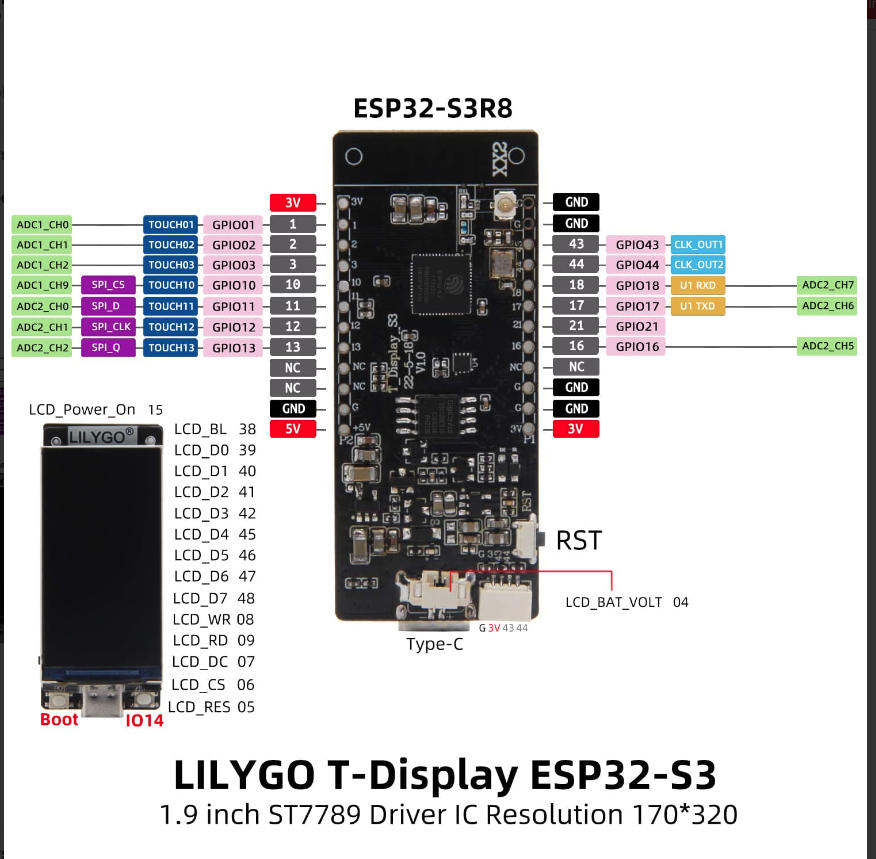
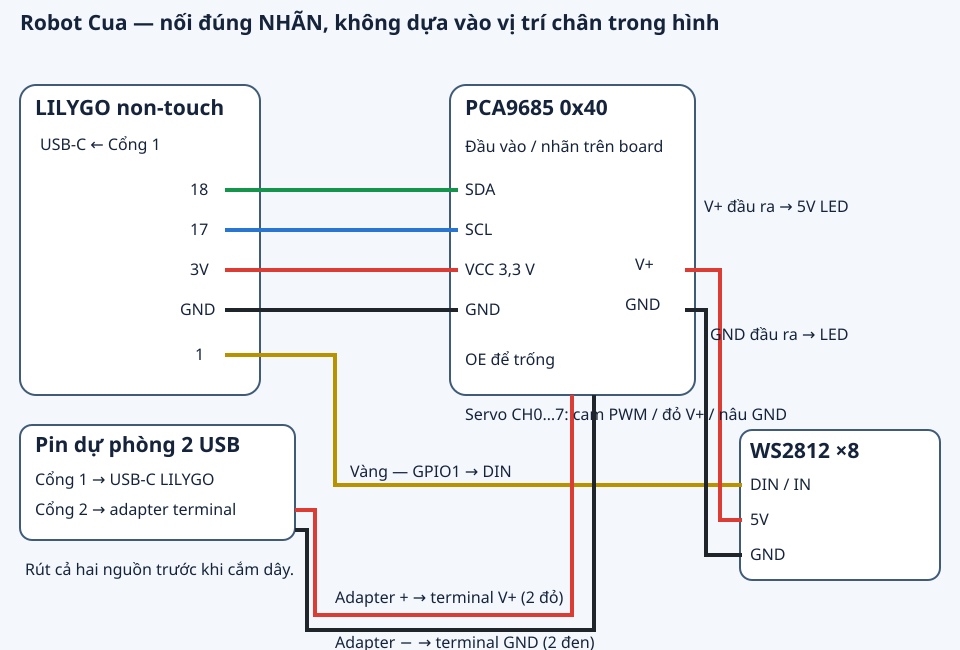
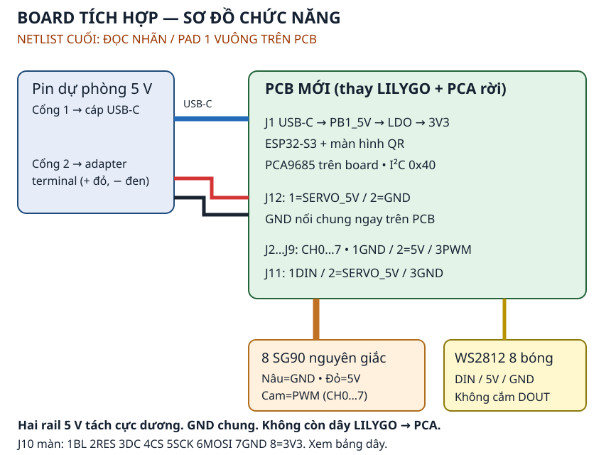

# Wiring — use the printed labels

Two variants are supported. The original LILYGO and separate PCA9685 use the first table; the integrated PCB already contains those functions. Disconnect both bank outputs before changing any wire. Wire colours are suggestions; matching labels at both ends decide the connection.

## Original LILYGO and bought PCA9685

Reference: LILYGO T-Display-S3 **non-touch**, schematic 2024-04-29, with soldered headers; PCA9685 breakout at default address 0x40. Clone pin positions can differ. Read the labels rather than copying the Arduino Uno pin numbers in a shop picture.

In this picture, **18 is on the right below 44; 17 is directly below 18**. Use the upper-left **3V** pin for logic power and a pin marked **G/GND** for ground. U1RXD/U1TXD are alternate functions, not fixed wiring requirements: this application configures GPIO18 as SDA and GPIO17 as SCL. The four connections below match the compiled LILYGO pin profile. The picture is a supplied reference diagram, not a photograph of the received PCA board.

First connect only these four logic wires with both supplies unplugged. Keep all servo plugs and the second bank output disconnected, then power LILYGO by USB and restart to check PCA detection.

| Suggested colour | From LILYGO | To |
|---|---|---|
| Green | `18` | PCA input `SDA` |
| Blue | `17` | PCA input `SCL` |
| Thin red | `3V` | PCA input `VCC` — **3.3 V logic** |
| Black | `G` / `GND` | PCA input `GND` |
| Yellow | `1` | LED input `DIN` / `IN`, directly |

Use female-to-female Dupont leads. Leave PCA `OE` unconnected on the reference breakout and leave unused pins alone. **PCA VCC and V+ are different:** VCC is 3.3 V logic; V+ is the separate 5 V servo supply. Never join them. Do not use GPIO16/43/44/3/4/21 or display pins for this variant.

Bank port 1 → data-capable USB-A/USB-C cable → LILYGO USB-C. Bank port 2 → labelled USB-to-terminal adapter → PCA screw terminal: `+` to `V+`, `−` to `GND`, using the specified parallel red/black power leads. Clamp metal, not insulation; gently tug each wire and inspect for a strand bridging the poles. The LILYGO–PCA GND lead must also be present.

From the PCA output-side power header, `V+` → LED `5V/VCC` and `GND` → LED `GND`. LED data comes from LILYGO GPIO1, not through a PWM channel. Use the LED input end and its direction arrow. Do not power the LED from LILYGO 3V/5V.

**ASSUMPTIONS:** the PCA has the Adafruit-style labelled functions, address bridges untouched and its normal OE pull-down; the LED accepts direct 3.3 V data. If the light flickers, shorten DIN beside GND, reduce configured brightness or choose a compatible stick; leave it disconnected if unresolved. If headers or LED leads are absent, have a soldering service fit them before use.

## Eight servos mean eight three-wire plugs

Stand behind the robot looking forward: robot left is your left. The **hip** servo is mounted on the body; the **knee** servo is carried on the leg. CH denotes a complete socket, not a wire colour or GPIO.

| Leg | Hip | Knee | Integrated PCB references |
|---|---|---|---|
| Front left | CH0 | CH1 | J2 / J3 |
| Front right | CH2 | CH3 | J4 / J5 |
| Rear left | CH4 | CH5 | J6 / J7 |
| Rear right | CH6 | CH7 | J8 / J9 |

For every plug, **brown → GND/−, red → V+/5V, orange → PWM/S**. Read the board labels. For example, front-left CH0/CH1 means two separate plugs, one per servo. Do not split one servo's wires between channels. Leave CH8–CH15 empty and the two spare servos loose.

Label all eight leads before routing. Keep slack across each joint and protect insulation from rough edges. On the new frame use the illustrated alternative routes and at least 40 mm free knee lead between its two ties; use an extension when necessary. These CAD routes target the integrated PCB. They do not prove complete routes for the current separate modules in the owner's modified orange body.

## Integrated board

Follow the English [illustrated integrated wiring guide](../docs/INTEGRATED-WIRING.md) for all J10/J11/J12 pins and connector orientation.

Bank port 1 powers **J1 USB-C**, logic and LCD. Bank port 2 powers **J12** servos/LED. Their positive rails remain separate; the PCB joins ground. The separately bought PCA9685 and LILYGO are not installed on this variant. The supplied Waveshare 23822 eight-wire LCD cable connects by signal names, not wire colour.

J1 faces **+Y, the robot's left**. Its native PCB origin is X21.45/Y−28, rotation 180°. The ordinary-cable CAD check passes for a **12.5 × 7 × 25 mm head and Ø4.5 mm cable**. Route from bank port 1 through the rear bay/end window, along the outside of the +Y rail and into the side port. The head projects about 20 mm beyond the body; keep that space free. Actual cable fit remains a first-board check.

## First power and centring

Have the custom-PCB assembler perform its electrical inspection first. For either variant, initially leave port 2 and the servo plugs disconnected. Power logic and check QR/Wi-Fi using the correct firmware target. If PCA is absent, a PCA wiring error is expected; correct wiring while unpowered and restart because an I²C fault remains latched until reboot.

Turn both outputs off before adding servos. **Uncouple already installed horns/legs from their output shafts**, support the body and use **Ráp → Giữa thô 1500 µs** before attaching horns in the neutral pose. Continue with **Tư thế đứng**, small trims, **Lưu tâm** and **Xong ráp**. See the [firmware instructions](README.md) and [physical checklist](../case/CHECKLIST-RAP.md). Do not force gears or use powered movement to overcome binding.

Use a closed two-output 5 V bank meeting the [mechanical BOM](../case/BOM.md). If it shuts down, choose **Chậm**, check binding and change to a suitable bank if necessary. Warm wiring requires power off and a suitable replacement. Resetting or holding BOOT does not cut servo/LED power; disconnect output 2 before reset/flashing and both outputs to turn everything off. The new PCB/frame remain physically untested.
