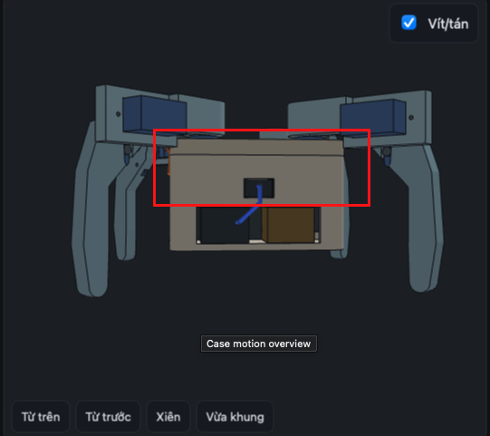
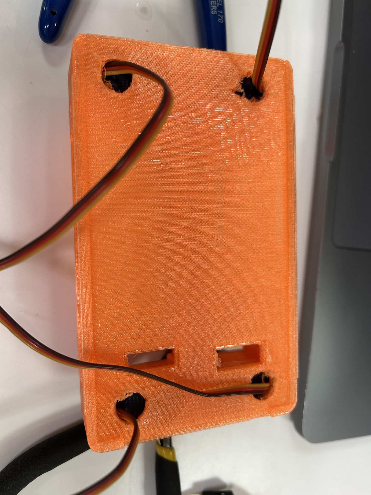
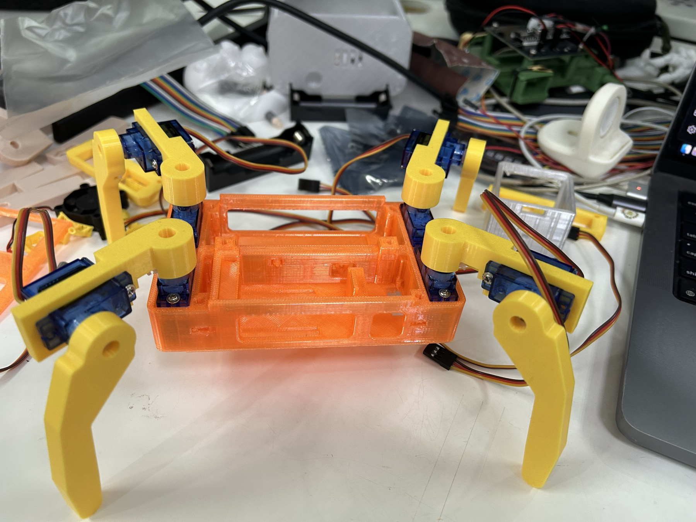
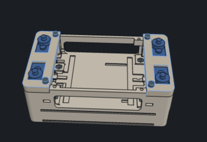

# Owner's prints and assembly feedback — 2026-11-10

The owner reports both production plates finished printing. For the plate-1 box they cut away the lower portion **in the slicer before printing**, keeping only the upper frame inside the red rectangle below. The lower portion is not an available printed part.

This is an owner-annotated CAD screenshot, not a photograph of the physical print. Exact source revision, cut height, cropped mesh/hash, material/color, physical fit and strength are unverified. Red indicates the retained region, not filament color. The remaining plate-1 items were not enumerated; the plate-2 association with the earlier frozen two-clamp/eight-leg-part plan is likely from project history, not a newly measured physical mesh match.

The owner then trial-mounted servos in the body pockets and found no usable wire-routing path. Their explicit repair requirement is an **open load-bearing skeleton of bars/cross-members, with alternate wire routes**, rather than walls, closed servo cups or a single cable tunnel. Skin/enclosure panels are deferred until the owner specifically requests skin. No successful complete assembly, powered motion or fit/strength test is implied.

## Later physical assembly evidence

The owner then reported mechanical assembly complete and supplied these real photos:

Four rough hand-made openings in the orange body's underside carry servo leads. Four yellow legs and eight blue servos are mechanically installed. The photos establish neither exact mesh identity nor dimensions, neutral calibration, retention strength or powered motion. No controller, screen or power bank is visibly installed. Only four leads are shown passing through the openings; the knee-lead route is unproven. The openings' edges need inspection for chafing and the surrounding plastic for cracks, without further cutting being assumed.

## Removed clamp bars

The owner explicitly reports that both clamp bars collided with the servos, so they removed the bars and used screws through the servo tabs directly into the body. This image identifies the parts in CAD; it is not a photo of the modification. Screw sizes, lengths, new hole geometry and holding strength are unknown.

Both bars remain **printed, removed and unused** inventory. Their interfaces must no longer be treated as known working interfaces. Preserve the four thighs, four feet, servo axes and useful horn interfaces; provide open direct-tab servo retention in the replacement frame. The earlier assumption that all ten plate-2 pieces should be retained in the installed assembly is superseded by this failure report.

The bar-only/no-skin repair request remains in force. These photos do not show a print or physical test of its new frame, or of the unmanufactured integrated controller. Do not relabel the custom-cut body as a complete current CAD base, derive millimeters from these images or schedule a whole-kit reprint merely because physical mesh identity is uncertain. Identify only the minimum necessary structural replacement.

## PCA9685 arrival and pinout clarification — 2026-11-10

The owner reports that the missing bought board has arrived and asks how to wire the LILYGO. In the preceding purchase context this is the PCA9685 breakout, not a manufactured integrated controller. The attached [LILYGO product pinout](user-images/2026-11-10-owner-supplied-lilygo-pinout.png) is reference artwork, not a physical PCA photograph. GPIO18/17 are configured as SDA/SCL by the existing LILYGO firmware despite the diagram also showing their alternate UART functions. Follow the [original-module guide](../firmware/WIRING.md#original-lilygo-and-bought-pca9685). No new wiring, servo-power or motion result is inferred from receipt.

After the four-wire hookup instructions, the owner reports that both boards light their LEDs on the first attempt. This is an owner-reported power indication. No photograph or PCA acknowledgement, calibration, servo-load or walking result is established by that report.

## Servo rotation and reversed polarity — 2026-11-10

The owner subsequently reports no motion on a forward command, finds reversed terminal polarity, then reports the servos spinning and confirms that all purchased units were the “360°” variant. The exact seller classification is not yet verified. Continuous rotation is suspected from the description; positional 360° and effects of the reversed-polarity event cannot be excluded from the generic SG90 labels in the photos. No controlled joint-angle or walking success is established. The current design remains calibrated for positional 180° servos. The supplied photos also show a separate bare-cell/charger setup, rather than the specified closed bought USB bank; no output voltage, current capability, protection or polarity is inferred from those photographs. Keep power disconnected while resolving the actuator type and wiring.

## Owner follow-up — 2026-11-11

The owner reports that all eight continuous SG90s are installed and each worked when tested separately on the original LILYGO/PCA9685 assembly. The owner also reports manually setting every hip and elbow at the proposed 90° reference. These observations concern the old modified body and retained leg prints, not the unprinted r5 frames or integrated PCB. Exact pulse/stop values, per-direction speed measurements, supply rating, stopping on release, loaded clearance and walking are not established by these reports. No new print is reported.
